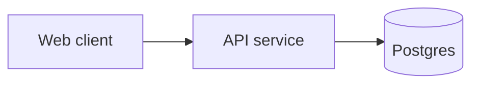
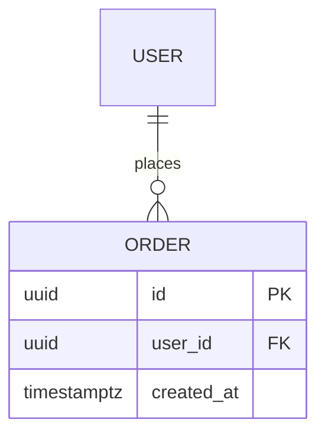
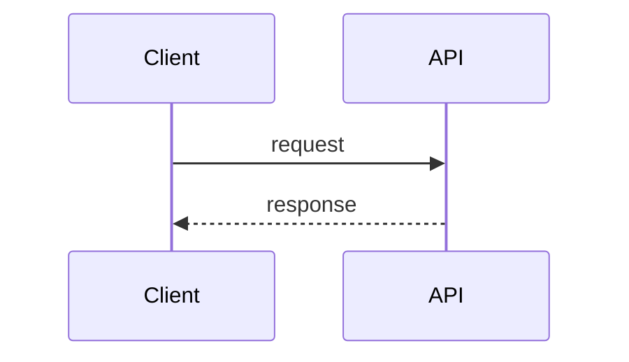
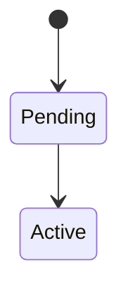

# <Feature name>: Architecture Design

> **Approval gate:** `status` stays `draft` until the user reviews this document and approves it,
> either by setting `approved` themselves or by explicitly telling Claude to. `/tech-lead` refuses to
> run until then. Any later change to this document resets `status` to `draft` and needs a new approval.

## 1. Overview
<What is being built technically and the shape of the solution in one paragraph. Link to
[product.md](product.md).>

**Key decisions**
1. <decision>: <one-line rationale>

## 2. Requirements traceability
| Requirement | Satisfied by (component / section) | Verified by (test level) |
|-------------|-------------------------------------|--------------------------|
| FR-1 | §5.1 OrderService, §7.1 `GET /orders` | integration + e2e (AC-1) |
| NFR-1 | §11 caching, §6 index `idx_orders_user_created` | load test |

## 3. Context, constraints and estimates
- **Existing system:** <stack, relevant modules, conventions this design follows>
- **Constraints:** <hard constraints from product brief or platform>
- **Load estimates (12-month):**
  | Quantity | Estimate | Derivation |
  |----------|----------|------------|
  | Peak read RPS | | |
  | Peak write RPS | | |
  | Rows / growth per year | | |
  | Payload size | | |

## 4. System architecture
<Caption: what this diagram shows.>

## 5. Components
### 5.1 <Component name>
- **Responsibility:** <single responsibility>
- **Location:** <repo path; new or existing module>
- **Interface:** <public functions/endpoints; see §7>
- **Owns data:** <tables/keys>
- **Depends on:** <components>

## 6. Data model
<Caption.>

### 6.1 <table_name>
| Column | Type | Null | Default | Constraints | Notes |
|--------|------|------|---------|-------------|-------|

**Indexes**
| Index | Columns | Serves query |
|-------|---------|--------------|

- **Retention / deletion:** <policy>
- **Migration & backfill:** <steps, backward compatibility, duration estimate>

## 7. Contracts
### 7.1 <METHOD /path> | <event name> | <module function>
- **Auth:** <who may call>
- **Request:** <schema with types, constraints>
- **Response:** <schema>
- **Errors:** | Code | When |
- **Idempotency / pagination / versioning:** <rules>

## 8. Key flows
### 8.1 <Flow name> (AC-1, AC-2)
<Caption.>

**Failure path:** <what happens when X fails; include a diagram for the main one>

## 9. State model
<Only if an entity has a lifecycle.>

## 10. Scalability
- Bottleneck at 10×: <what breaks first> → scale-up path: <plan>
- Horizontal scaling / statelessness / partitioning / async processing: <design>

## 11. Performance
- **Latency budget:** <per-hop allocation summing to the NFR target>
- **Hot queries & indexes:** <query → index>
- **Caching:** <what, key, TTL, invalidation, stampede protection>, or "none, because …"
- **Payload & pagination limits:** <limits>

## 12. Reliability and failure modes
| Dependency / failure | Impact | Detection | Mitigation (timeout, retry, fallback) |
|----------------------|--------|-----------|---------------------------------------|

Consistency & idempotency guarantees: <statement>

## 13. Security and privacy
- **AuthN / AuthZ per operation:** <rules>
- **Input validation:** <where, what>
- **Sensitive data:** <classification, encryption, masking in logs>
- **Abuse protection:** <rate limits, size caps>

## 14. Observability
| Signal | Name | Purpose (NFR) | Alert threshold |
|--------|------|---------------|-----------------|

## 15. Testing strategy
| Level | Scope | Covers ACs |
|-------|-------|------------|
| Unit | | |
| Integration | | |
| E2E | | |
| Load / perf | | NFR-… |

## 16. Rollout and migration
- **Feature flag:** <name, default>
- **Sequence:** <deploy order, migration order>
- **Backward compatibility:** <old clients / old data>
- **Rollback plan:** <steps>

## 17. Alternatives considered
| Option | Pros | Cons | Decision |
|--------|------|------|----------|

## 18. Risks and open questions
| ID | Risk / question | Impact | Mitigation / owner |
|----|-----------------|--------|--------------------|

## 19. Changelog
| Version | Date | Change |
|---------|------|--------|
| 1 | <YYYY-MM-DD> | Initial design |
