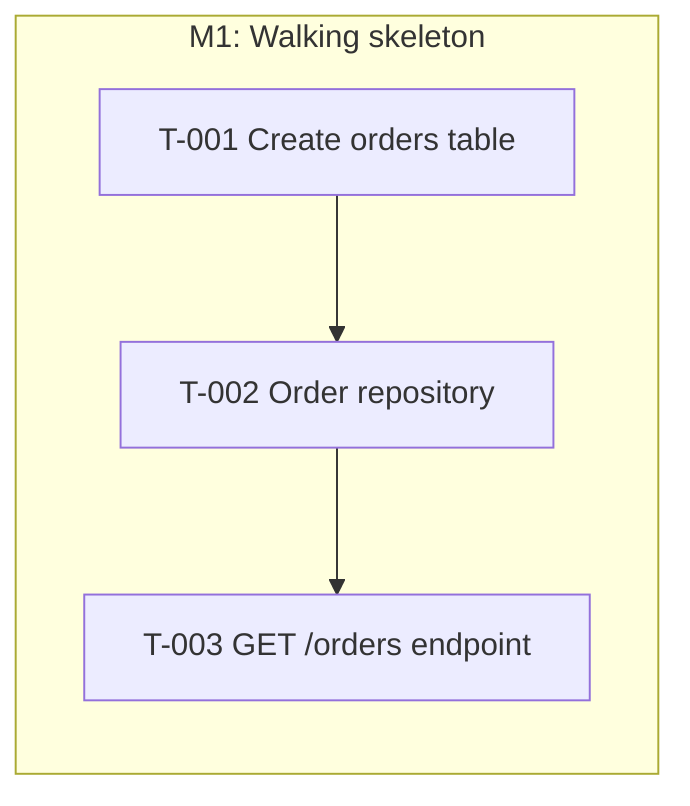

# <Feature name>: Delivery Plan

> **Approval gate:** `status` stays `draft` until a human reviews this plan and its task files and
> manually sets it to `approved`. Approving this plan approves every task file in `tasks/`.
> `/developer` (the task board) refuses to claim any task until then. Any later change to the
> plan or to a task's definition resets `status` to `draft` and needs a new human approval.
> Developers setting a task's own `status: done` doesn't count as a change.

Based on [architecture.md](architecture.md) v<version> and [product.md](product.md) v<version>.
Task status is **not** tracked here. Run `python3 .claude/skills/tech-lead/scripts/taskboard.py status --feature <slug>`.

## Milestones
| ID | Goal | Exit criteria (ACs passing) | Demo | Tasks |
|----|------|-----------------------------|------|-------|
| M1 | Walking skeleton: … | AC-1 | <how to show it works> | T-001 … T-004 |

## Dependency graph
<Caption: arrows point from a dependency to the task that needs it.>

## Critical path
T-001 → T-002 → T-003 (<sum of sizes>)

## Parallel lanes
| Lane | Tasks | Can start after |
|------|-------|-----------------|
| A (data) | T-001, T-002 | immediately |
| B (UI) | T-005 | immediately (against stubbed contract from T-004) |

## Acceptance criteria coverage
| AC | Task(s) | Test level |
|----|---------|------------|
| AC-1 | T-003 | integration |

## Task index
| ID | Title | Milestone | Size | Depends on |
|----|-------|-----------|------|------------|
| T-001 | | M1 | S | — |

## Risks to the plan
- <risk>: <mitigation, e.g. spike task T-00x first>
