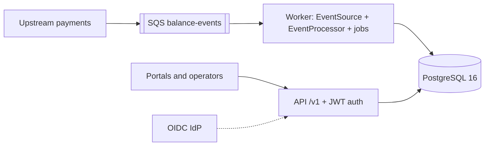

# Marketplace Balance Service: Architecture Summary

> A 2–3 minute summary of [architecture.md](architecture.md) (v3). The full design is authoritative.

## The design in one paragraph
One TypeScript service with one PostgreSQL 16 database, run as two roles from the same codebase.
The **worker** reads events from SQS through a channel-agnostic `EventSource` port. It applies each
event in a single transaction that records the event ID, writes append-only ledger entries, and
updates materialized balances and fee aggregates. The **api** role serves a versioned REST API
(`/v1`) secured with OIDC JWTs. There is no cache or extra service. The single transaction makes exactly-once and
"balance = sum of transactions" true by construction (§1).

## Components
Process roles and their dependencies (§4).

| Component | Responsibility |
|-----------|----------------|
| Ingestion (§5.1) | Port, SQS adapter and canonical-event parser. Acks only after the outcome is committed |
| EventProcessor (§5.2) | Applies an event exactly once: fee, ledger, balances, pending and failed handling, reprocess |
| FeeRules (§5.3) | Versioned, append-only rules. Selects the rule by the payment's `occurred_at`, vendor override first |
| Money (§5.4) | Pure BigInt math in minor units, round-half-up, fee cap, proportional refund reversal |
| HTTP API (§5.5) | Balances, history, vendor list, fee report, fee rules, ops endpoints. Tenant checks from claims |
| Jobs (§5.6–5.7) | Pending-refund sweeper (24 h), daily reconciliation, partition maintenance, gauges |

## Key decisions
- **Ledger plus materialized balances in one transaction:** rejected computing balances on read,
  which can't meet NFR-2 or sort vendors by balance (§17).
- **Idempotency through a `processed_event` row in the same transaction, then ack:** at-least-once
  delivery with an exactly-once effect. A standard SQS queue is enough, and FIFO was rejected
  because events can still be out of order upstream (§12, §17).
- **`EventSource` port:** Kafka, HTTP push or a backfill replay needs only a
  new adapter (§5.1, §6.13).
- **`bigint` minor units with the fee rate in parts-per-million:** exact rounding (AC-2). The last
  refund reverses the remaining fee, so there's no drift. A single event is capped at 10¹⁵ minor
  units, which catches upstream unit mix-ups and keeps every amount far below the `bigint`
  maximum (§5.4, §7.1).
- **`fee_daily` and `fee_monthly` aggregates:** a 1-year report reads about 370k small rows
  instead of about 180M ledger rows (§6.9).
- **Partitioning from day one:** the ledger monthly, `payment` and `processed_event` by hash, for
  about 2B ledger rows a year and 7-year retention (§6.3).
- **Verified libraries over own code:** each one is
  trust-checked (§3). Deprecated `prom-client` and AGPL `k6` were rejected. Small needs
  are hand-written.

## How it meets the hard requirements
| Requirement | How |
|-------------|-----|
| NFR-1: p95 ≤ 5 s to visible | Long-poll consumer plus a transaction under 100 ms, about 2 s p95 budget (§11) |
| NFR-2: reads p95 ≤ 300 ms, report ≤ 2 s | Point and keyset index reads (about 80 ms), report from aggregates (§11) |
| NFR-3: 500 events/s | 32 concurrent handlers, about 6× headroom (§10) |
| NFR-4: 0 discrepancies | Atomic writes plus daily checkpointed reconciliation (§5.7) |
| NFR-5: RPO 0 | Ack after commit, RDS synchronous standby, DLQ after 10 receives (§12) |
| NFR-7: tenant isolation | Claims-only 403 before any query, and a generated cross-tenant test suite (§13, §15) |
| NFR-9: audit | Append-only tables enforced by DB grants and triggers, `created_by` on rules (§6) |

## Top risks and failure modes
- A dominant platform's fee-balance row caps at about 250 updates/s. The row is locked last, and
  the scale path is per-vendor fee totals (§10).
- Postgres failover pauses ingestion for 1–2 min. Messages aren't acked, so nothing is lost (§12).
- The upstream message format isn't confirmed yet (OQ-1).

## Decisions
Accepted with the v3 approval (2026-11-28):
- **OQ-3 (deviation from FR-21):** operators may back-date a platform's *first* fee rule, so that
  AC-13 can pass.
- **OQ-7:** `jose` (JWT) is accepted despite a single maintainer (§17).

Still open, with defaults:
- **OQ-1:** the upstream's real SQS payload. Default: upstream publishes our canonical v1 event,
  otherwise we add a mapper. This blocks go-live, not the build.
- **OQ-4:** hosting. Default: AWS ECS Fargate plus RDS Multi-AZ.
- **OQ-2, OQ-5, OQ-6:** JWT claim names, access to upstream records for shadow mode, and
  `as_of` using event time (default).
