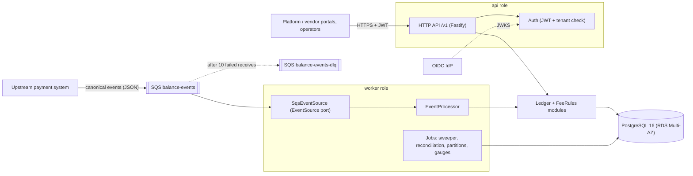
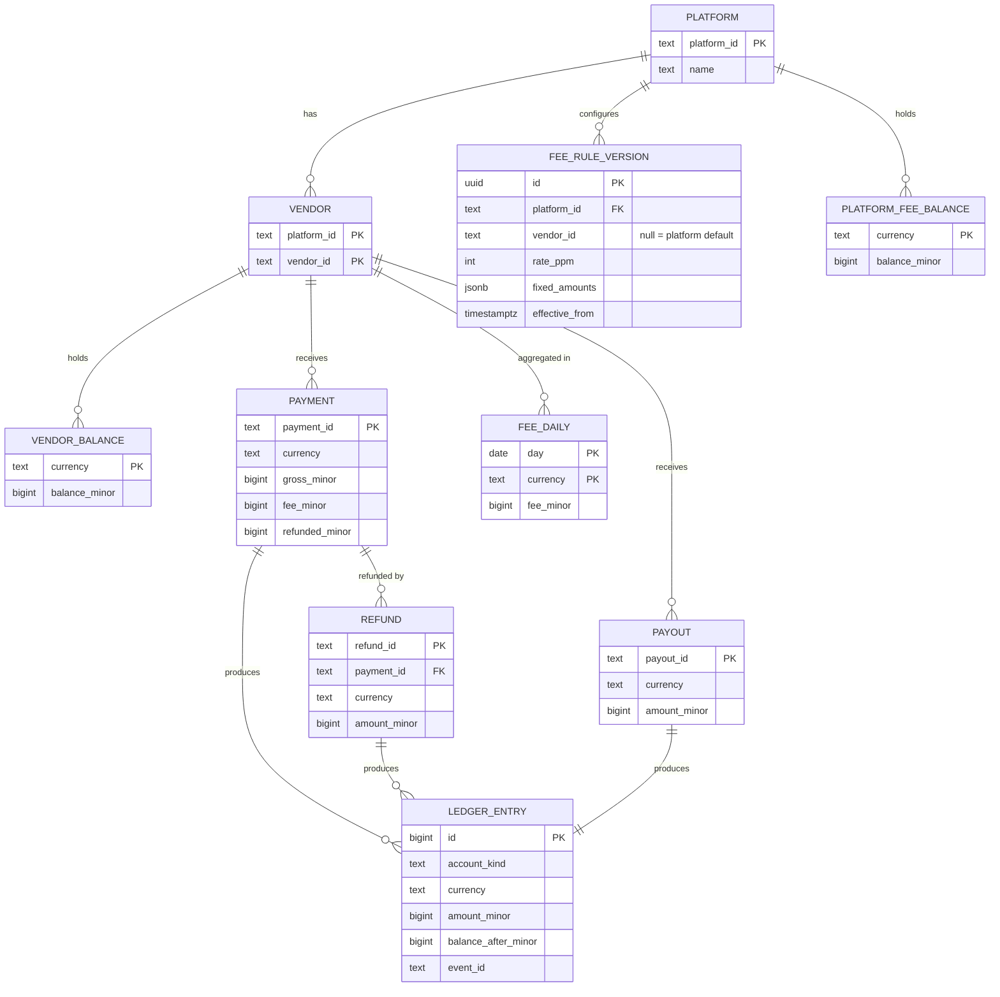
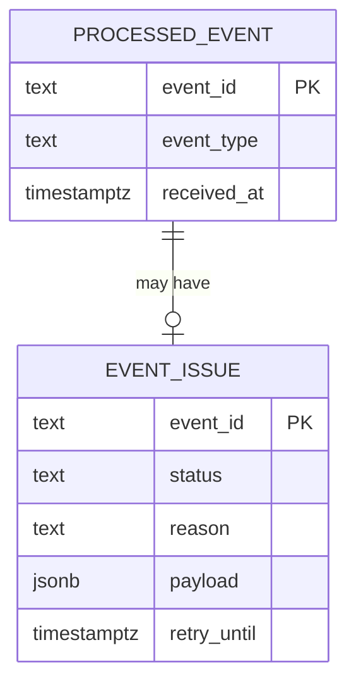
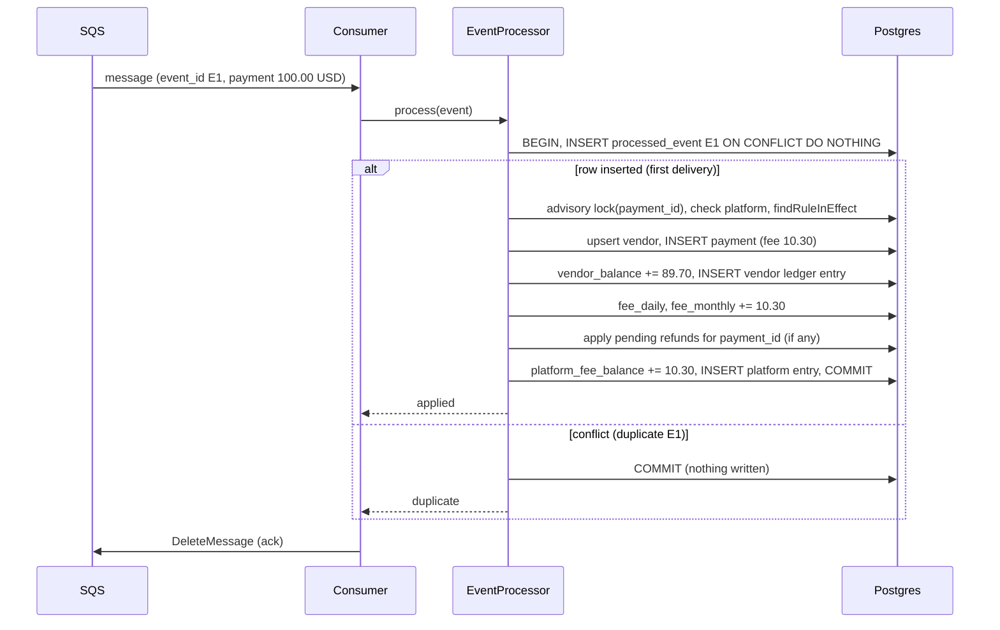
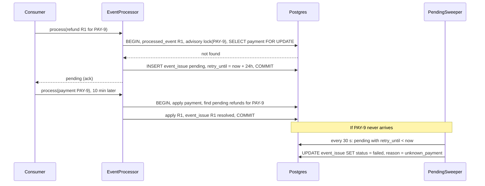
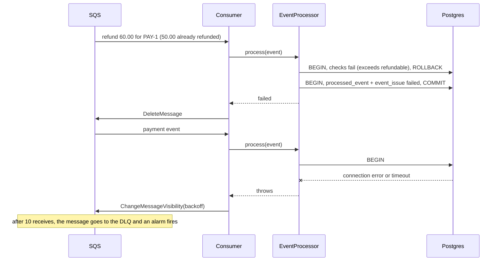
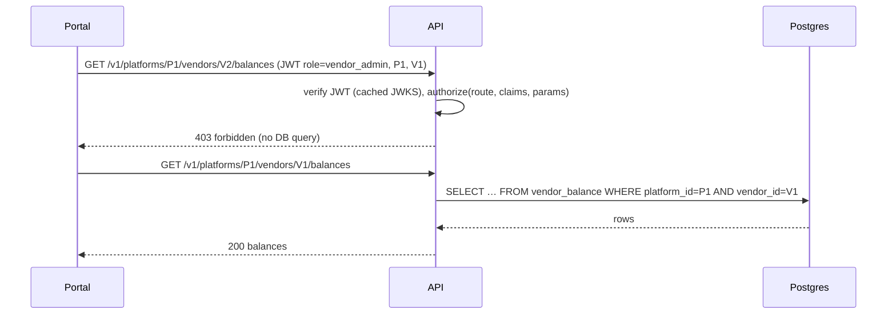
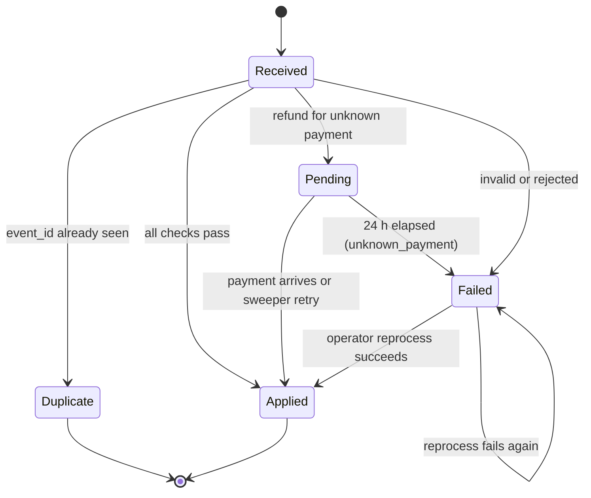

# Marketplace Balance Service: Architecture Design

> **Approval gate:** `status` stays `draft` until the user reviews this document and approves it,
> either by setting `approved` themselves or by explicitly telling Claude to. `/delivery:tech-lead` refuses to
> run until then. Any later change to this document resets `status` to `draft` and needs a new approval.

## 1. Overview
We build one TypeScript service, `balance-service`, backed by one PostgreSQL 16 database. It runs
as two process roles from the same codebase:

- The **worker** reads canonical payment, refund and payout events from an SQS queue through a
  channel-agnostic `EventSource` port. It applies each event in **one database transaction** that
  records the event ID (idempotency), writes append-only **ledger entries** and updates the
  materialized **balance rows** and **fee aggregates**.
- The **api** role serves a versioned REST API (`/v1`) to platform and vendor portals and to
  operators. Callers are authenticated with OIDC JWTs, and tenant access is decided from token
  claims before any data is read.

Refunds that arrive before their payment are parked for up to 24 h. Events that can't be applied go
to a failed-events list that operators can reprocess. A daily job reconciles every balance against
its ledger. See [product.md](product.md) (v1).

**Resolved during design (answers to the brief's blocking questions):**
- **Q-1 (event channel):** events arrive on an **AWS SQS** queue. The ingestion layer must be
  channel-agnostic so that the transport can be swapped later. For now it is a simple SQS
  consumer. The upstream payload schema is still unconfirmed (OQ-1).
- **Q-2 (identity):** callers present **OIDC JWTs** from the existing identity provider. Claims
  carry the caller's role, `platform_id`, and `vendor_id` for vendor admins.
- **Stack:** TypeScript on Node.js 26 LTS plus PostgreSQL 16, matching the repository's Node
  `.gitignore`. Libraries are in §3.

**Key decisions**
1. **Ledger plus materialized balances in one Postgres transaction:** this gives exactly-once
   effect, makes "balance = sum of transactions" (FR-17) true by construction, and serves reads
   with single-row lookups.
2. **Idempotency by event ID inside the same transaction:** `processed_event` is inserted with
   `ON CONFLICT DO NOTHING` in the same transaction as the ledger writes. A duplicate is a no-op,
   and the SQS message is deleted only after the commit, so no event is lost (NFR-5).
3. **`EventSource` port, with SQS as its only adapter today:** a standard (non-FIFO) queue is
   enough, because the design already tolerates duplicates and out-of-order events. Moving to
   Kafka or HTTP push later only requires a new adapter.
4. **Integer minor units and exact BigInt fee math:** amounts are `bigint` in minor units, the fee
   percentage is stored in parts-per-million, and rounding is half-up. There is no floating point
   anywhere.
5. **Pre-aggregated fee tables (`fee_daily`, `fee_monthly`):** they are updated in the same
   transaction, so a 1-year fee report reads at most about 400k small rows, not about 180M ledger
   rows (NFR-2).
6. **One deployable with two roles, no cache, no extra infrastructure:** no Redis, no read replica
   and no separate microservices. Postgres point and index reads fit the latency budget.

## 2. Requirements traceability
| Requirement | Satisfied by (component / section) | Verified by (test level) |
|-------------|-------------------------------------|--------------------------|
| FR-1 | §5.1 Ingestion, §7.1 canonical event `payment`, §8.1 | unit (parser) + integration (AC-1, AC-25) |
| FR-2 | §7.1 `refund`, §5.2 EventProcessor, §8.2 | integration (AC-5, AC-7) |
| FR-3 | §7.1 `payout`, §8.1 (payout variant) | integration (AC-10) |
| FR-4 | §5.3 FeeRules `findRuleInEffect`, §6.4 index `ix_fee_rule_lookup` | unit + integration (AC-14, AC-16) |
| FR-5 | §5.4 `calculateFee` (cap, ≥ 0), §6.4 `rate_ppm`, `fixed_amounts` | unit (AC-1, AC-3, AC-4) |
| FR-6 | §5.4 `toMinor`, `roundHalfUpDiv`, ISO 4217 exponent table | unit (AC-2) |
| FR-7 | §8.1 payment transaction, §6.7 ledger, §6.8 balances | integration (AC-1, AC-4) |
| FR-8 | §5.4 `refundFeeReversal`, §8.2 | unit + integration (AC-5, AC-11) |
| FR-9 | §8.2 refundable/currency checks on the locked `payment` row | integration (AC-6) |
| FR-10 | §8.1 payout variant | integration (AC-10) |
| FR-11 | §6.8 `negative_since`, §7.4 `GET /v1/ops/negative-balances`, §14 metric | integration (AC-11) |
| FR-12 | §6.8 PK includes `currency`, no FX anywhere | integration (AC-4) |
| FR-13 | §6.10 `processed_event` PK, §8.1 duplicate branch, §12 | integration (AC-9) |
| FR-14 | §6.11 `event_issue` pending + `retry_until`, §5.6 PendingSweeper, §8.2 | integration (AC-7, AC-8) |
| FR-15 | §6.11 `event_issue` failed + reasons (§7.1), §8.3 | integration (AC-6, AC-8, AC-12, AC-25) |
| FR-16 | §7.4 failed-events list + reprocess, §8.6 | integration (AC-13) |
| FR-17 | §6.7 every entry has `event_id`, §5.7 Reconciliation | integration + daily job (AC-23) |
| FR-18 | §7.2 vendor balances + transactions | integration (AC-17, AC-19, AC-20) |
| FR-19 | §7.2 `GET …/vendor-balances`, transactions for any own vendor | integration (AC-18) |
| FR-20 | §7.2 `GET …/fees`, §6.9 `fee_daily`/`fee_monthly` | integration (AC-21) + perf (NFR-2) |
| FR-21 | §7.3 `POST …/fee-rules`, §6.4 append-only versions, §8.5 | integration (AC-14, AC-15) |
| FR-22 | §7.3 `POST …/vendors/{v}/fee-rules`, §5.3 override-first lookup | integration (AC-16) |
| FR-23 | Out of scope (Won't) | — |
| FR-24 | Out of scope (Won't) | — |
| FR-25 | §7.2 `as_of` parameter, §6.7 covering indexes | integration (AC-22) |
| FR-26 | §7.3 `GET …/vendors/{v}/fee-rule` | integration |
| FR-27 | §8.1 vendor upsert, §7.4 `POST /v1/platforms`, failure reasons | integration (AC-12) |
| NFR-1 | §5.1 consumer, §10 throughput, §11 budget, §14 `event_apply_lag_seconds` | load (AC-24) |
| NFR-2 | §11 latency budget + indexes, §6.9 fee aggregates | load/perf test |
| NFR-3 | §3 estimates, §6 partitioning, §10 | load test at 500 events/s |
| NFR-4 | §5.7 Reconciliation, §12 consistency guarantees | daily job + integration (AC-23) |
| NFR-5 | §12 ack-after-commit, SQS retention + DLQ, RDS Multi-AZ synchronous standby + PITR | failover drill |
| NFR-6 | §10 stateless API ≥ 2 instances across AZs, §12 ingestion pause/catch-up | chaos test (stop worker 1 h) |
| NFR-7 | §13 claims-based authorization before DB access, §15 generated cross-tenant suite | integration (AC-17, AC-18) |
| NFR-8 | §13 TLS, KMS encryption at rest, data minimization | config review |
| NFR-9 | §6.4/§6.7 append-only (DB grants + triggers), `created_by`, 7-year retention | integration |
| NFR-10 | §14 metrics + alerts | integration (metrics exposed) |
| NFR-11 | N/A (no UI) | — |
| NFR-12 | §7 `/v1` path versioning, canonical `schema_version`, deprecation policy | contract tests |

## 3. Context, constraints and estimates
- **Existing system:** none. The repository is greenfield (only docs and a Node `.gitignore`), so
  there are no installed dependencies to reuse. Chosen stack: **Node.js 26 LTS** (the current
  Active LTS, v26.13.1) with **TypeScript** in strict mode, ESM, and **PostgreSQL 16**. Every
  library is listed in the *Libraries* table below. SQL is hand-written in repository modules
  (no ORM, §17). Assumed hosting: AWS, with containers on ECS Fargate and RDS for PostgreSQL 16
  Multi-AZ (OQ-4).
- **Constraints:** events arrive via SQS (Q-1) and may be duplicated or out of order (A-7). Auth is
  OIDC JWT (Q-2). There's no card data or end-client PII (NFR-8), ledger and rule history are kept
  for 7 years and are append-only (NFR-9), and no FX (FR-12).
- **Load estimates (12-month):**
  | Quantity | Estimate | Derivation |
  |----------|----------|------------|
  | Peak event writes | 500 events/s | NFR-3 |
  | Avg event writes | ~60 events/s (5M/day ÷ 86,400) | NFR-3 |
  | DB writes per event | ~6 row writes (processed_event, payment/refund/payout, 1–2 ledger, 1–2 balance, 2 fee aggregates) | §8.1 |
  | Peak DB row writes | ~3,000/s | 500 × 6 |
  | Hottest single row | `platform_fee_balance` of the largest platform: ~150 updates/s | assume 30% of traffic on one platform |
  | Peak read RPS | 200 req/s | NFR-2 |
  | Read/write ratio (requests) | ~1:2.5 at peak | 200 reads vs 500 events |
  | Ledger rows | ~1.8 entries/event → ~2B rows in year 1 (avg ~3M events/day), ~3.3B/yr at the 12-month rate | payment 2, refund 2, payout 1 entries |
  | Ledger storage | ~250 B/row incl. indexes → ~0.5 TB in year 1 | estimate |
  | `payment` rows | ~1B/yr | ~90% of events are payments (assumed) |
  | `vendor_balance` rows | ~150k (100k vendors × ~1.5 currencies) | NFR-3 |
  | Fee report worst case | 5,000 vendors × (12 monthly + ≤ 62 daily rows) ≈ 370k aggregate rows | §6.9 |
  | Event payload | ≤ 2 KB JSON. SQS limit is 256 KB | canonical schema §7.1 |
  | API response | ≤ 100 items × ~400 B ≈ 40 KB | page cap 100 |

**Libraries** (common utilities and patterns this design does not write itself)

All libraries are new, because the repository has no `package.json` yet. Figures were checked on
2026-11-26:
- weekly downloads from the npm downloads API
- latest release, license and maintainer count from registry.npmjs.org
- stars, archive status and the number of distinct commit authors in the last 12 months from the GitHub API
- advisories from the GitHub Advisory Database

Every pin uses a caret range whose floor is at or above the latest patched advisory.

| Need | Library and version | New or existing | Trust evidence (usage, last release, maintainers, advisories, license) |
|------|---------------------|-----------------|-------------------------------------------------------------------------|
| Language / compiler | `typescript@^7.0.2` (dev) | new | 442M/wk, 112k★, 7.0.2 on 2026-07-08, Microsoft org, no advisories, Apache-2.0 |
| HTTP server | `fastify@^5.12.8` | new | 23.5M/wk, 37k★, 5.12.8 on 2026-11-02, Fastify org (OpenJS Foundation), 45 committers. All advisories fixed by 5.12.6. MIT. Types bundled |
| Validation, schemas, env config | `zod@^4.6.7` | new | 463M/wk, 44k★, 4.6.7 on 2026-10-12, 4 committers plus sponsors. High advisory GHSA-mrhx-c7xc-m3w5 fixed in 4.6.6. MIT. Types bundled |
| OpenAPI spec from routes | `@fastify/swagger@^9.9.5` | new | 4.7M/wk, 1.1k★, 9.9.5 on 2026-11-16, Fastify org, no advisories, MIT. Schemas fed from zod v4's built-in `z.toJSONSchema()` |
| Rate limiting | `@fastify/rate-limit@^11.3.0` | new | 5.3M/wk, 11.3.0 on 2026-11-20, Fastify org (11 committers), no advisories, MIT. **606★ is below the 1,000 guideline.** Accepted, because it is an official Fastify-org plugin with 5M+ weekly downloads |
| PostgreSQL driver and pool | `pg@^8.23.1` + `@types/pg@^8.23.1` (dev) | new | 104M/wk, 13k★, 8.23.1 on 2026-09-30, 36 committers in 12 months. The only advisory (critical) affects ≤ 7.1.x. MIT. Types from DefinitelyTyped (102M/wk, 2026-08-17) |
| DB migrations | `node-pg-migrate@^9.0.0` | new | 1.4M/wk, 1.5k★, 9.0.0 on 2026-07-17, Salsita org, 4 npm maintainers, no advisories, MIT. Requires Node ≥ 20.11 |
| SQS client and retries | `@aws-sdk/client-sqs@^3.1178.0` | new | 21.6M/wk, 3.1178.0 on 2026-11-25, AWS org, no advisories, Apache-2.0. Retries use the SDK's built-in standard retry mode (exponential backoff with jitter), so no separate retry library is needed |
| JWT verification and JWKS caching | `jose@^6.2.18` | new | 239M/wk, 7.9k★, 6.2.18 on 2026-11-18, no advisories in v5+, MIT. Types bundled. `createRemoteJWKSet` provides JWKS caching, cooldown and a fetch timeout. **Effectively one maintainer, so it fails the "not a single point of failure" check.** Accepted as an exception (OQ-7): the org-backed alternatives are weaker (§17) |
| Logging | `pino@^10.4.0` | new | 80M/wk, 18k★, 10.4.0 on 2026-10-02, pinojs org (36 committers), no advisories, MIT. Has built-in `redact` |
| Metrics and traces | `@opentelemetry/sdk-node@^0.301.2`, `@opentelemetry/api@~1.10.0`, `@opentelemetry/exporter-prometheus@^0.301.2`, `@opentelemetry/auto-instrumentations-node@^0.83.1` | new | 29.6M/wk (sdk-node), 3.5k★, 0.301.2 on 2026-11-12, CNCF project (22+ committers). High GHSA-q7rr-3cgh-j5r3 fixed in 0.217 / 0.75. Apache-2.0. Replaces `prom-client`, which is deprecated (§17). Requires Node ≥ 22.15 |
| Test runner | `vitest@^5.1.2` (dev) | new | 190M/wk, 17k★, 5.1.2 on 2026-11-25, vitest-dev org, all advisories fixed before 5.0.0-rc.2, MIT. Supports Node 26 |
| Real Postgres and SQS in tests | `testcontainers@^12.2.2`, `@testcontainers/postgresql@^12.2.2`, `@testcontainers/localstack@^12.2.2` (dev) | new | 12.4M/wk, 2.7k★, 12.2.2 on 2026-11-19, Testcontainers org (13 committers), no advisories, MIT. Requires Node ≥ 22.22 |
| HTTP load generation | `autocannon@^9.0.0` (dev) | new | 909k/wk, 8.5k★, 9.0.0 on 2026-11-06, 3 npm maintainers, no advisories, MIT. Chosen over k6, which is AGPL-3.0 (§17) |

Hand-written instead of a library:
- **ISO 4217 minor-unit table** (`src/domain/iso4217.ts`). No library passes: `currency-codes`
  had no release since 2024-10-23. `Intl` uses CLDR digits, which differ from ISO 4217 for some
  currencies (FR-6 requires ISO). The table is generated once from the published ISO 4217 list
  and has a unit test.
- **Decimal string ↔ `bigint` minor units and round-half-up** (`money.ts`). The need is too small
  to justify a dependency (about 30 lines on native `BigInt`), and a general decimal library would
  invite floating-point misuse.
- **zod validator and serializer compilers for Fastify** (`src/api/zod-compilers.ts`). The need is
  too small (about 20 lines on zod v4's `safeParse` and `z.toJSONSchema`). The one library for
  it, `fastify-type-provider-zod`, has 591★ and is a personal repository.
- **Job scheduling** (`src/jobs/scheduler.ts`). The need is too small: three fixed intervals via
  `node:timers/promises` `setInterval`, a Postgres advisory lock, and a "due" check against
  `reconciliation_run` for the daily job. Cron libraries (`croner`, `node-cron`) each have one
  maintainer.
- **Consumer concurrency.** The need is too small: `concurrency` independent polling loops.
  `p-limit` has one maintainer.
- **Standard library** for everything else: cursors (`Buffer` base64url), hashing
  (`node:crypto` sha256), UTC day and month bucketing (`Date.UTC`), and IDs (Postgres
  `gen_random_uuid()`).

## 4. System architecture
Components, process roles and external dependencies. Both roles share the domain modules and the database.


## 5. Components
Code lives in one package at the repository root (`package.json`, `src/`, `test/`, `migrations/`).
The module boundaries below are the units for parallel work. Each module exposes only its
`index.ts`.

### 5.1 Ingestion (`src/ingestion/`)
- **Responsibility:** pull raw messages from a transport, map them to the canonical event, hand
  them to `EventProcessor`, and ack or release based on the outcome. It holds no business logic.
- **Location:** new. `event-source.ts` (port), `sqs-event-source.ts` (adapter),
  `canonical-event.ts` (zod schema + parser), `mapper.ts` (upstream → canonical; identity for
  now), `consumer.ts` (generic loop).
- **Interface:**
  ```ts
  export interface InboundMessage {
    readonly body: string;
    readonly sourceMessageId: string;      // SQS MessageId; used only in logs
    readonly receiveCount: number;          // SQS ApproximateReceiveCount
    readonly publishedAt: Date;             // SQS SentTimestamp; for NFR-1 lag metric
  }
  export interface EventSource {
    receive(maxMessages: number): Promise<InboundMessage[]>;            // long poll; [] when idle
    ack(message: InboundMessage): Promise<void>;                        // delete from source
    release(message: InboundMessage, delaySeconds: number): Promise<void>; // make visible again
  }
  export interface EventMapper { toCanonical(body: string): unknown }  // raw JSON → candidate object
  export function parseCanonicalEvent(candidate: unknown): ParseResult;
  export type ParseResult =
    | { ok: true; event: CanonicalEvent }
    | { ok: false; eventId: string; reason: 'invalid_data'; detail: string; payload: unknown };
  export function runConsumer(deps: {
    source: EventSource; mapper: EventMapper; processor: EventProcessor;
    concurrency: number; signal: AbortSignal;
  }): Promise<void>;
  ```
  `runConsumer` starts `concurrency` independent loops. Each one receives up to 10 messages and
  processes them one at a time. The consumer **acks** on `applied | duplicate | pending | failed` (each one is durably recorded
  in Postgres). It **releases** with backoff `min(2^receiveCount, 300)` s on a thrown error
  (transient errors such as DB unavailable or a serialization failure). If a message has no usable
  `event_id`, the parser derives `eventId = "invalid:" + sha256(body)`, so that repeated invalid
  messages are deduplicated too.
- **SQS adapter settings:** standard queue `balance-events`, long-poll `WaitTimeSeconds=20`,
  `MaxNumberOfMessages=10`, visibility timeout 60 s, message retention 14 days, redrive to
  `balance-events-dlq` after `maxReceiveCount=10`, SSE-KMS. Every SQS call has a 25 s client
  timeout. The SDK's standard retry mode makes up to 3 attempts with exponential backoff and
  jitter. All SQS calls here are idempotent.
- **Owns data:** none.
- **Depends on:** EventProcessor (§5.2).

### 5.2 EventProcessor (`src/ledger/event-processor.ts`)
- **Responsibility:** apply one canonical event exactly once: idempotency, validation against
  state, fee calculation, ledger and balance writes, the pending and failed classification, and
  the reprocessing of an event already in `event_issue`.
- **Location:** new module `src/ledger/` (`event-processor.ts`, `apply-payment.ts`,
  `apply-refund.ts`, `apply-payout.ts`, `ledger-repository.ts`, `balance-repository.ts`,
  `issue-repository.ts`).
- **Interface:**
  ```ts
  export type FailureReason =
    | 'invalid_data' | 'unknown_platform' | 'no_fee_rule' | 'unknown_payment'
    | 'exceeds_refundable_amount' | 'currency_mismatch'
    | 'duplicate_payment_id' | 'duplicate_refund_id' | 'duplicate_payout_id';
  export type ProcessOutcome =
    | { status: 'applied' }
    | { status: 'duplicate' }
    | { status: 'pending'; reason: 'unknown_payment'; retryUntil: Date }
    | { status: 'failed'; reason: FailureReason; detail: string };
  export interface EventProcessor {
    process(event: CanonicalEvent): Promise<ProcessOutcome>;            // first delivery path
    recordInvalid(result: Extract<ParseResult, { ok: false }>): Promise<ProcessOutcome>;
    reprocess(eventId: string, actor: string): Promise<ProcessOutcome | { status: 'not_found' }>;
  }
  ```
- **Owns data:** `processed_event`, `event_issue`, `payment`, `refund`, `payout`, `ledger_entry`,
  `vendor`, `vendor_balance`, `platform_fee_balance`, `fee_daily`, `fee_monthly`.
- **Depends on:** FeeRules (§5.3), Money (§5.4), Postgres.

### 5.3 FeeRules (`src/fee-rules/`)
- **Responsibility:** create and list fee rule versions (platform default and vendor override),
  and resolve the rule in effect for (platform, vendor, time).
- **Interface:**
  ```ts
  export interface FeeRule { versionId: string; ratePpm: number; fixedAmounts: Record<string, bigint> }
  export interface FeeRuleVersion {
    id: string; platformId: string; vendorId: string | null;
    ratePpm: number | null;               // null = vendor override reverts to platform default
    fixedAmounts: Record<string, bigint>; // currency → minor units; missing currency = 0
    effectiveFrom: Date; createdAt: Date; createdBy: string; createdByRole: Role;
  }
  export function findRuleInEffect(tx: Tx, platformId: string, vendorId: string, at: Date):
    Promise<FeeRule | null>;              // override first, then platform default
  export function createRuleVersion(input: CreateRuleInput, actor: Actor, now: Date):
    Promise<FeeRuleVersion>;              // throws EffectiveFromInPastError, IdempotencyConflictError
  export function listRuleVersions(platformId: string, vendorId: string | null | undefined,
    page: PageRequest): Promise<Page<FeeRuleVersion>>;
  export function getEffectiveRule(platformId: string, vendorId: string, at: Date):
    Promise<{ source: 'vendor_override' | 'platform_default'; rule: FeeRuleVersion;
              nextScheduled: FeeRuleVersion | null } | null>;
  ```
- **Owns data:** `fee_rule_version`.
- **Depends on:** Postgres, `platform` (existence check).

### 5.4 Money (`src/domain/money.ts`, `src/domain/fees.ts`)
- **Responsibility:** pure, deterministic money math with no I/O.
- **Interface:**
  ```ts
  export function minorUnitExponent(currency: string): number;     // ISO 4217 table; throws if unsupported
  export function toMinor(amount: string, currency: string): bigint; // "100.00","USD" → 10000n; rejects excess scale
  export function fromMinor(minor: bigint, currency: string): string; // 10000n → "100.00", -8000n → "-80.00"
  export const MAX_EVENT_AMOUNT_MINOR = 10n ** 15n;                  // per-event sanity limit (§7.1)
  export function roundHalfUpDiv(numerator: bigint, denominator: bigint): bigint; // for numerator ≥ 0
  export function percentToPpm(percentage: string): number;        // "2.9" → 29000; max 4 dp; 0..100
  export function calculateFee(grossMinor: bigint, rule: { ratePpm: number; fixedMinor: bigint }): bigint;
  // = min(gross, roundHalfUpDiv(gross * ratePpm, 1_000_000) + fixedMinor), never < 0
  export function refundFeeReversal(p: { grossMinor: bigint; feeMinor: bigint;
    refundedMinor: bigint; refundedFeeMinor: bigint }, refundMinor: bigint): bigint;
  // if refundedMinor + refundMinor === grossMinor → feeMinor − refundedFeeMinor (remainder, no drift)
  // else roundHalfUpDiv(feeMinor * refundMinor, grossMinor)
  ```
  Checks: AC-1 `calculateFee(10000n, {ratePpm:100000, fixedMinor:30n}) = 1030n`. AC-2
  `1025 × 29000 / 1e6 = 29.725 → 30n`. AC-3 gives `min(20, 2+30) = 20n`. AC-5 gives
  `1030 × 5000 / 10000 = 515n`. Limit: `10n ** 15n` is accepted and `10n ** 15n + 1n` is
  rejected as `invalid_data`.
- **Overflow:** intermediate products (`gross * ratePpm`, `feeMinor * refundMinor`) are computed in
  `BigInt`, which has no upper bound. Only the results are stored in Postgres `bigint`
  (max ≈ 9.2 × 10¹⁸). The per-event limit keeps every stored amount at least ~9,000× below that
  maximum. SQL totals use `SUM(bigint)`, which returns `numeric`. If a column ever overflows,
  Postgres raises `bigint out of range` and the transaction rolls back, so a balance is never
  silently wrong.
- **Owns data:** the ISO 4217 exponent table (`src/domain/iso4217.ts`, hand-written, see §3).

### 5.5 HTTP API (`src/api/`)
- **Responsibility:** routing, JWT authentication, per-route tenant authorization, request
  validation, pagination cursors, the problem+json error format and rate limiting.
- **Location:** new. `server.ts`, `auth.ts`, `authorize.ts`, `pagination.ts`, `errors.ts`,
  `zod-compilers.ts` (wires zod into Fastify validation and `@fastify/swagger`),
  `routes/{balances,transactions,fees,fee-rules,ops,platforms}.ts`, `route-table.ts` (the single
  list of routes and their allowed roles, also used by the generated NFR-7 test suite).
- **Interface:** §7.2–§7.4.
- **Owns data:** `platform` (create via operator route).
- **Depends on:** Ledger read repositories, FeeRules, EventProcessor (`reprocess`), OIDC JWKS.

### 5.6 Jobs (`src/jobs/`, run inside the worker role)
`scheduler.ts` drives each job with `node:timers/promises` `setInterval` (no cron library, see
§3). Each job takes a Postgres advisory lock (`pg_try_advisory_lock(<job id>)`), so only one
worker instance runs it at a time. The daily jobs tick every 5 min and run only when they're due.
For reconciliation, that means it is past 02:00 UTC and no `reconciliation_run` exists for
today's cutoff.
- **PendingSweeper** (every 30 s): for `event_issue` rows with `status='pending'`, it calls
  `reprocess` when the payment now exists. Once `retry_until < now()`, it marks the row `failed`
  with reason `unknown_payment`.
- **Reconciliation** (daily at 02:00 UTC): see §5.7.
- **PartitionMaintenance** (daily): creates `ledger_entry` monthly partitions 3 months ahead, and
  raises an alert if the default partition holds any rows.
- **GaugeRefresher** (every 15 s): refreshes the open failed-event count, the oldest failed age,
  the pending count and the negative-balance count (§14).

### 5.7 Reconciliation (`src/jobs/reconciliation.ts`)
- **Responsibility:** prove NFR-4 and FR-17 every day.
- **Checks** (cutoff = run start − 5 min):
  1. **Balance = sum of transactions:** for each account touched since the last checkpoint,
     `checkpoint.verified_sum + SUM(amount_minor of entries recorded in (verified_through, cutoff])`
     must equal the `balance_after_minor` of that account's latest entry at or before the cutoff,
     and the `balance_minor` of the balance row must equal the `balance_after_minor` of its latest
     entry.
  2. **Exactly-once:** every `processed_event` received before the cutoff and not in an open
     `event_issue` has exactly the expected ledger entries (payment 2, refund 2, payout 1). No
     ledger entry lacks a `processed_event`. No `event_id` appears twice for the same
     `account_kind`.
  3. **Aggregates:** `fee_daily` sums for the previous day equal the `platform_fee` ledger sums for
     that day.
- **Output:** a `reconciliation_run` row, the `reconciliation_discrepancies` gauge and an alert if
  it is > 0. Checkpoints only advance when an account reconciles cleanly. A monthly full recompute
  without checkpoints runs on Sunday off-peak.
- **Owns data:** `reconciliation_run`, `reconciliation_checkpoint`.

## 6. Data model
Ledger and balances. Each event creates one domain record (payment, refund or payout) and 1–2 ledger entries.


Ingestion bookkeeping. These tables have no FKs to the ledger, so they can be written before validation.


Conventions:
- All money is `bigint` in **minor units**. `currency` is `char(3)`, upper-case, and checked
  against the ISO 4217 table in code.
- External IDs (`platform_id`, `vendor_id`, `payment_id`, `refund_id`, `payout_id`, `event_id`)
  are `text`, 1–64 chars (`event_id` 1–128), pattern `^[A-Za-z0-9._:-]+$`.
- Timestamps are `timestamptz` in UTC.
- Append-only tables (`ledger_entry`, `fee_rule_version`, `payment`, `refund`, `payout`,
  `processed_event`) are protected in two ways. The application DB role has no `UPDATE`/`DELETE`
  on them, except `UPDATE` on `payment.refunded_*` through a column-level grant. A
  `BEFORE UPDATE OR DELETE` trigger raises an exception, as defence in depth.

### 6.1 platform
| Column | Type | Null | Default | Constraints | Notes |
|--------|------|------|---------|-------------|-------|
| platform_id | text | no | | PK | external ID, also the JWT `platform_id` claim |
| name | text | no | | 1–200 chars | |
| created_at | timestamptz | no | now() | | |
| created_by | text | no | | | operator `sub` |

**Indexes:** PK only (lookup by ID).

### 6.2 vendor
| Column | Type | Null | Default | Constraints | Notes |
|--------|------|------|---------|-------------|-------|
| platform_id | text | no | | PK, FK → platform | |
| vendor_id | text | no | | PK | unique within platform (no global-uniqueness assumption) |
| created_at | timestamptz | no | now() | | |
| first_event_id | text | yes | | | event that auto-registered it (FR-27). Null if created by an override |

**Indexes:** PK `(platform_id, vendor_id)`, used for existence checks and the upsert.

### 6.3 Partitioning summary
| Table | Scheme | Why |
|-------|--------|-----|
| `ledger_entry` | RANGE by `occurred_at`, monthly. A default partition catches out-of-range rows | ~2–3B rows/yr. Date-range queries prune, and 7-year retention drops whole partitions |
| `payment` | HASH by `payment_id`, 16 partitions | ~1B rows/yr with only point lookups by ID. Keeps each index and vacuum unit small |
| `processed_event` | HASH by `event_id`, 16 partitions | ~2B rows/yr. The PK must stay globally unique, and hashing on the key allows that |

Partitioning is set up in the first migration, because retrofitting it on billion-row tables is costly.

### 6.4 fee_rule_version (append-only)
| Column | Type | Null | Default | Constraints | Notes |
|--------|------|------|---------|-------------|-------|
| id | uuid | no | gen_random_uuid() | PK | |
| platform_id | text | no | | FK → platform | |
| vendor_id | text | yes | | | null = platform default, otherwise a vendor override (FR-22) |
| rate_ppm | integer | yes | | CHECK 0 ≤ rate_ppm ≤ 1,000,000. CHECK (rate_ppm IS NOT NULL OR vendor_id IS NOT NULL) | null only for an override that reverts to the default |
| fixed_amounts | jsonb | no | '{}' | CHECK jsonb_typeof = 'object' | `{"USD": "30"}`: currency → non-negative minor units as a string. Missing currency = 0 |
| effective_from | timestamptz | no | | | ≥ `created_at` (FR-21). The single exception is in §8.5 |
| created_at | timestamptz | no | now() | | |
| created_by | text | no | | | JWT `sub` (NFR-9) |
| created_by_role | text | no | | CHECK IN ('platform_admin','operator') | |
| idempotency_key | text | yes | | UNIQUE (platform_id, idempotency_key) | from the `Idempotency-Key` header |
| request_hash | text | yes | | | sha256 of the canonical request body, to detect key reuse with a different body |

**Indexes**
| Index | Columns | Serves query |
|-------|---------|--------------|
| `ix_fee_rule_lookup` | (platform_id, vendor_id, effective_from DESC, created_at DESC) | rule in effect: `WHERE platform_id=$1 AND vendor_id=$2 AND effective_from <= $3 ORDER BY effective_from DESC, created_at DESC LIMIT 1`, then the same with `vendor_id IS NULL`. Also the history list and `nextScheduled` |
| `ux_fee_rule_idem` | UNIQUE (platform_id, idempotency_key) WHERE idempotency_key IS NOT NULL | idempotent POST |

When two versions share the same `effective_from`, the later `created_at` wins.

### 6.5 payment (HASH partitioned by payment_id; `refunded_*` columns updatable)
| Column | Type | Null | Default | Constraints | Notes |
|--------|------|------|---------|-------------|-------|
| payment_id | text | no | | PK | |
| platform_id | text | no | | | |
| vendor_id | text | no | | | |
| currency | char(3) | no | | | |
| gross_minor | bigint | no | | CHECK > 0 | |
| fee_minor | bigint | no | | CHECK 0 ≤ fee_minor ≤ gross_minor | |
| refunded_minor | bigint | no | 0 | CHECK 0 ≤ refunded_minor ≤ gross_minor | FR-9 is also enforced by the DB |
| refunded_fee_minor | bigint | no | 0 | CHECK 0 ≤ refunded_fee_minor ≤ fee_minor | |
| fee_rule_version_id | uuid | no | | FK → fee_rule_version | which rule priced it (transparency) |
| event_id | text | no | | | |
| occurred_at | timestamptz | no | | | |
| recorded_at | timestamptz | no | now() | | |

**Indexes:** PK only (refunds look up by `payment_id`).

### 6.6 refund / payout (append-only)
**refund**
| Column | Type | Null | Default | Constraints | Notes |
|--------|------|------|---------|-------------|-------|
| refund_id | text | no | | PK | duplicate `refund_id` with a new `event_id` → failed `duplicate_refund_id` |
| payment_id | text | no | | | |
| platform_id, vendor_id | text | no | | | copied from the payment |
| currency | char(3) | no | | | |
| amount_minor | bigint | no | | CHECK > 0 | |
| fee_reversal_minor | bigint | no | | CHECK ≥ 0 | |
| event_id | text | no | | | |
| occurred_at / recorded_at | timestamptz | no | — / now() | | |

Index `ix_refund_payment (payment_id)` serves "refunds of a payment" (operator investigation).

**payout**
| Column | Type | Null | Default | Constraints | Notes |
|--------|------|------|---------|-------------|-------|
| payout_id | text | no | | PK | duplicate → failed `duplicate_payout_id` |
| platform_id, vendor_id | text | no | | | |
| currency | char(3) | no | | | |
| amount_minor | bigint | no | | CHECK > 0 | |
| event_id | text | no | | | |
| occurred_at / recorded_at | timestamptz | no | — / now() | | |

PK only.

### 6.7 ledger_entry (append-only; RANGE partitioned monthly by occurred_at)
| Column | Type | Null | Default | Constraints | Notes |
|--------|------|------|---------|-------------|-------|
| id | bigint | no | identity | PK (id, occurred_at) | |
| account_kind | text | no | | CHECK IN ('vendor','platform_fee') | |
| platform_id | text | no | | | |
| vendor_id | text | no | | | for `platform_fee` this is the vendor whose transaction produced the fee (per-vendor breakdown) |
| currency | char(3) | no | | | |
| entry_type | text | no | | CHECK IN ('payment','refund','payout') | |
| amount_minor | bigint | no | | | signed effect on **this account's** balance |
| gross_minor | bigint | no | | | signed, from the vendor's view: payment +gross, refund −refund, payout −amount |
| fee_minor | bigint | no | | | signed: payment +fee, refund −reversal, payout 0 |
| net_minor | bigint | no | | | signed: gross − fee |
| balance_after_minor | bigint | no | | | account balance right after this entry, in application order |
| event_id | text | no | | | FR-17 source event |
| payment_id | text | yes | | | set for payment and refund |
| refund_id | text | yes | | | |
| payout_id | text | yes | | | |
| occurred_at | timestamptz | no | | partition key | |
| recorded_at | timestamptz | no | now() | | |

Per event: **payment** → vendor entry (`amount = net`) and platform_fee entry (`amount = fee`).
**Refund** → vendor entry (`amount = −(refund − reversal)`) and platform_fee entry
(`amount = −reversal`). **Payout** → vendor entry (`amount = −payout`).

**Indexes** (created on the partitioned parent, so they exist per partition)
| Index | Columns | Serves query |
|-------|---------|--------------|
| `ix_ledger_vendor_hist` | (platform_id, vendor_id, occurred_at DESC, id DESC) INCLUDE (currency, entry_type, amount_minor) WHERE account_kind='vendor' | vendor history with keyset pagination and date/type/currency filters (FR-18/19). Also vendor `as_of` balance via an index-only `SUM … WHERE occurred_at <= $t GROUP BY currency` (FR-25) |
| `ix_ledger_platform_asof` | (platform_id, currency, occurred_at) INCLUDE (amount_minor) WHERE account_kind='platform_fee' | platform fee balance `as_of` (FR-25) |
| `ix_ledger_recorded` | (recorded_at) | reconciliation window scans (§5.7) |
| `ix_ledger_event` | (event_id) | traceability lookups and the reconciliation exactly-once check |

- **Retention / deletion:** hard delete only by detaching and dropping partitions older than
  7 years (after an archive export, out of scope). There is no soft delete.

### 6.8 vendor_balance / platform_fee_balance (materialized; updated in the event transaction)
**vendor_balance**
| Column | Type | Null | Default | Constraints | Notes |
|--------|------|------|---------|-------------|-------|
| platform_id, vendor_id | text | no | | PK, FK → vendor | |
| currency | char(3) | no | | PK | FR-12 |
| balance_minor | bigint | no | 0 | | may be negative (FR-11) |
| last_entry_id | bigint | no | | | |
| last_applied_at | timestamptz | no | | | "stale data" indicator in responses |
| last_occurred_at | timestamptz | no | | | |
| negative_since | timestamptz | yes | | | set when the balance goes below 0, cleared when ≥ 0 (FR-11 flag) |

| Index | Columns | Serves query |
|-------|---------|--------------|
| PK | (platform_id, vendor_id, currency) | vendor's balances, and the row lock during apply |
| `ix_vbal_platform_sorted` | (platform_id, currency, balance_minor DESC, vendor_id) | platform vendor list sorted by balance, with keyset pagination (FR-19). Ascending order scans it backwards |
| `ix_vbal_negative` | (negative_since) WHERE balance_minor < 0 | ops list of negative balances, and the gauge |

**platform_fee_balance:** PK (platform_id, currency), `balance_minor`, `last_entry_id`,
`last_applied_at`, `last_occurred_at`. PK only.

### 6.9 fee_daily / fee_monthly (aggregates; updated in the event transaction)
| Column | Type | Null | Default | Constraints | Notes |
|--------|------|------|---------|-------------|-------|
| platform_id | text | no | | PK | |
| currency | char(3) | no | | PK | |
| day (or month) | date | no | | PK | UTC day of `occurred_at`. `month` = first day of the month |
| vendor_id | text | no | | PK | |
| fee_minor | bigint | no | 0 | | net of refund reversals (FR-20) |

PK `(platform_id, currency, day, vendor_id) INCLUDE (fee_minor)` serves
`SELECT vendor_id, SUM(fee_minor) … WHERE platform_id=$1 AND currency=$2 AND day BETWEEN …`.
The report reads whole months from `fee_monthly` and the partial leading and trailing months from
`fee_daily`.

### 6.10 processed_event (append-only; HASH partitioned by event_id)
| Column | Type | Null | Default | Constraints | Notes |
|--------|------|------|---------|-------------|-------|
| event_id | text | no | | PK | FR-13 idempotency |
| event_type | text | no | | | `payment`, `refund`, `payout`, or `unknown` for unparsable messages |
| received_at | timestamptz | no | now() | | |

PK only. An event is *applied* when it has a row here and no open `event_issue`.

### 6.11 event_issue (pending and failed events)
| Column | Type | Null | Default | Constraints | Notes |
|--------|------|------|---------|-------------|-------|
| event_id | text | no | | PK | |
| event_type | text | no | | | |
| status | text | no | | CHECK IN ('pending','failed','resolved') | |
| reason | text | no | | one of `FailureReason` | latest reason |
| detail | text | yes | | ≤ 1,000 chars | |
| payload | jsonb | no | | | canonical event (or the raw candidate for invalid data). Needed for reprocessing |
| platform_id | text | yes | | | for filtering |
| payment_id | text | yes | | | pending refunds wait on this |
| first_received_at | timestamptz | no | now() | | |
| last_attempt_at | timestamptz | no | now() | | |
| attempts | integer | no | 1 | | |
| retry_until | timestamptz | yes | | | pending only: `first_received_at + 24 h` (FR-14) |
| resolved_at | timestamptz | yes | | | |
| resolved_by | text | yes | | | `system` or the operator `sub` |

| Index | Columns | Serves query |
|-------|---------|--------------|
| `ix_issue_status_age` | (status, first_received_at, event_id) | ops list (keyset), oldest-failed gauge, sweeper expiry scan |
| `ix_issue_pending_payment` | (payment_id) WHERE status='pending' | "apply refunds waiting for this payment" inside the payment transaction |

Resolved rows are kept for 7 years (audit). The table is small, since failures are < 0.01% of events (M-3).

### 6.12 reconciliation_run / reconciliation_checkpoint
- `reconciliation_run`: `id bigint identity PK`, `cutoff timestamptz`, `started_at`,
  `finished_at`, `accounts_checked int`, `discrepancies int`, `details jsonb` (first 1,000
  discrepancies). Index on `started_at DESC`.
- `reconciliation_checkpoint`: PK (`account_kind`, `platform_id`, `vendor_id` (`''` for
  platform), `currency`), `verified_sum_minor bigint`, `verified_through timestamptz`.

### 6.13 Migration and backfill
- Greenfield, so there's no existing data (A-1). The first migration creates every table,
  partition and index, plus the DB roles (`balance_app` with the restricted grants and
  `balance_migrator`).
- Historical backfill (Q-3, open) needs no new path: a one-off `FileEventSource` (or
  `S3EventSource`) adapter replays historical canonical events through the same `EventProcessor`.
  Idempotency makes reruns safe. The fee rule versions in effect historically must be created
  first, using the operator back-dating exception in §8.5.

## 7. Contracts
### 7.1 Canonical event v1 (SQS message body, JSON, UTF-8)
- **Producer:** the upstream payment system. If its native format differs, an `EventMapper`
  translates it (OQ-1). **Consumer:** the worker.
- **Schema:**
  ```jsonc
  {
    "schema_version": 1,                       // integer, required; unknown version → invalid_data
    "event_id": "evt_8f2c…",                   // string 1–128, ^[A-Za-z0-9._:-]+$, globally unique per publisher
    "event_type": "payment",                   // "payment" | "refund" | "payout"
    "occurred_at": "2026-11-25T10:00:00.000Z", // RFC 3339 with offset; ≤ now + 1 h, else invalid_data
    "data": { /* per type, below; additional properties rejected */ }
  }
  ```
  | event_type | `data` fields (all required strings) |
  |------------|--------------------------------------|
  | payment | `platform_id`, `vendor_id`, `payment_id`, `amount`, `currency` |
  | refund | `refund_id`, `payment_id`, `amount`, `currency` |
  | payout | `platform_id`, `vendor_id`, `payout_id`, `amount`, `currency` |

  `amount` is a decimal string in **major units** (`^\d+(\.\d+)?$`). It must be > 0 and have no
  more decimals than the currency's ISO 4217 exponent. Once converted to minor units, it must be
  ≤ `MAX_EVENT_AMOUNT_MINOR` (10¹⁵: 10 trillion USD, or about $10M worth of IRR). This is a
  sanity limit against upstream unit mix-ups, not a business limit. `currency` must be an
  ISO 4217 code in the supported table.
- **Outcomes and failure reasons** (written to `event_issue.reason`, displayed by ops endpoints):
  | Reason | When | Display text |
  |--------|------|--------------|
  | `invalid_data` | schema violation, negative/zero amount, amount above `MAX_EVENT_AMOUNT_MINOR`, unsupported currency, excess decimals, future `occurred_at` | "invalid data" |
  | `unknown_platform` | platform not registered (payment, payout) | "unknown platform" |
  | `no_fee_rule` | no rule in effect at `occurred_at` (payment) | "no fee rule" |
  | `unknown_payment` | refund's payment still absent after 24 h | "unknown payment" |
  | `exceeds_refundable_amount` | `refunded + amount > gross` | "exceeds refundable amount" |
  | `currency_mismatch` | refund currency ≠ payment currency | "currency mismatch" |
  | `duplicate_payment_id` / `duplicate_refund_id` / `duplicate_payout_id` | same business ID under a different `event_id` | "duplicate payment/refund/payout ID" |
- **Idempotency:** by `event_id` (FR-13). **Versioning:** a breaking change adds
  `schema_version: 2`. The parser supports N and N−1 during migration.

### 7.2 Read API
Common to all HTTP routes:
- Base `https://<host>/v1`. JSON. `Authorization: Bearer <JWT>` is required everywhere except
  `GET /healthz` and `GET /readyz`.
- **Money** is shown as a decimal string in major units with currency-exponent digits, such as
  `"89.70"` and `"-80.00"`, always next to a `currency` field.
- **Pagination:** `limit` is 1–100 (default 50) and `cursor` is an opaque base64url keyset token.
  Responses have the shape `{ "data": [...], "next_cursor": string | null }`. A cursor used with
  different filters → 400 `invalid_cursor`.
- **Errors** are `application/problem+json`: `{ "type", "title", "status", "code", "detail" }`.
  Common codes: `400 invalid_request`, `400 invalid_cursor`, `401 unauthenticated`,
  `403 forbidden`, `404 not_found`, `429 rate_limited` (with `Retry-After`), `500 internal`,
  `503 unavailable`.
- **Tenant rule** (§13): `{platformId}` and `{vendorId}` path parameters are checked against token
  claims **before** any DB access. A mismatch → `403 forbidden` with an identical body whether or
  not the resource exists.

#### GET /v1/platforms/{platformId}/vendors/{vendorId}/balances
- **Auth:** vendor_admin (own platform and vendor), platform_admin (own platform), operator.
- **Query:** `as_of` (optional, RFC 3339, must be ≤ now). It is the balance as of that
  `occurred_at` (FR-25).
- **200:**
  ```json
  { "platform_id": "P1", "vendor_id": "V1", "as_of": null,
    "balances": [ { "currency": "USD", "amount": "89.70",
                    "last_applied_at": "2026-11-25T10:00:01Z", "last_occurred_at": "2026-11-25T10:00:00Z" } ] }
  ```
  Currencies are sorted alphabetically. A vendor with no transactions returns `"balances": []`
  (AC-19). With `as_of`, `last_*` fields are null and amounts come from the ledger sum.
- **Errors:** `404 not_found` when the vendor is unknown within the caller's own platform
  (platform_admin or operator). A vendor_admin whose claims match an unregistered vendor gets
  `200` with empty balances, which avoids a 404 for a vendor who has not had their first event yet.
  `400 invalid_request` for a bad `as_of`.

#### GET /v1/platforms/{platformId}/vendors/{vendorId}/transactions
- **Auth:** as above.
- **Query:** `from`, `to` (RFC 3339, optional, on `occurred_at`, `from` inclusive and `to`
  exclusive), `type` (`payment|refund|payout`, optional), `currency` (optional), `limit`, `cursor`.
  Order: `occurred_at DESC, id DESC`.
- **200:** `data[]` items:
  ```json
  { "id": "123456", "type": "refund", "currency": "USD",
    "gross": "-50.00", "fee": "-5.15", "net": "-44.85", "balance_after": "44.85",
    "occurred_at": "2026-11-20T09:00:00Z", "recorded_at": "2026-11-20T09:00:01Z",
    "event_id": "evt_…", "payment_id": "PAY-1", "refund_id": "RF-1", "payout_id": null }
  ```
- **Errors:** 404 and 403 as above. `400` when `from > to`.

#### GET /v1/platforms/{platformId}/vendor-balances
- **Auth:** platform_admin (own), operator.
- **Query:** `currency` (required when sorting by balance), `sort` = `-balance` (default when
  `currency` is given) | `balance` | `vendor_id` (default otherwise), `limit`, `cursor`.
- **200:** `data[]`:
  `{ "vendor_id": "V1", "currency": "USD", "amount": "89.70", "last_applied_at": "…" }`.
  Vendors with no balances don't appear.

#### GET /v1/platforms/{platformId}/balances
- **Auth:** platform_admin (own), operator.
- **Query:** `as_of` (optional, FR-25).
- **200:** `{ "platform_id": "P1", "as_of": null, "balances": [ { "currency": "USD", "amount": "15.45", "last_applied_at": "…", "last_occurred_at": "…" } ] }`.
  This is the platform's fee balance.

#### GET /v1/platforms/{platformId}/fees
- **Auth:** platform_admin (own), operator.
- **Query:** `from`, `to` (required, `YYYY-MM-DD` UTC days, inclusive, span ≤ 731 days),
  `currency` (optional), `limit`, `cursor` (pages through `by_vendor`, ordered by
  `currency, vendor_id`).
- **200:**
  ```json
  { "platform_id": "P1", "from": "2026-11-01", "to": "2026-11-30",
    "totals": [ { "currency": "USD", "fees": "15.45" } ],
    "data": [ { "vendor_id": "V1", "currency": "USD", "fees": "15.45" } ],
    "next_cursor": null }
  ```
  `totals` is complete on every page. Fees are net of refund reversals, bucketed by each entry's
  `occurred_at` day (AC-21).
- **Errors:** `400 invalid_request` (bad dates, span too long).

### 7.3 Fee rule API
#### POST /v1/platforms/{platformId}/fee-rules (platform default) and POST /v1/platforms/{platformId}/vendors/{vendorId}/fee-rules (vendor override)
- **Auth:** platform_admin (own), operator (Q-5 default).
- **Headers:** `Idempotency-Key` (optional, 1–128 chars). A repeat with the same body returns the
  original `201` response. A repeat with a different body → `409 idempotency_key_reused`.
- **Request:**
  ```json
  { "percentage": "10", "fixed_amounts": { "USD": "0.30", "EUR": "0.25" },
    "effective_from": "2026-12-01T00:00:00Z" }
  ```
  - `percentage`: decimal string 0–100, ≤ 4 decimals. It is stored as `rate_ppm`.
  - `fixed_amounts`: object of ISO 4217 → non-negative decimal string. Optional (default `{}`).
  - `effective_from`: RFC 3339, optional (default: request time). It must be ≥ request time minus
    5 s of clock tolerance.
  - Override only: `{ "inherit_default": true, "effective_from": … }` reverts the vendor to the
    platform default (`rate_ppm = null`). It is mutually exclusive with `percentage` and
    `fixed_amounts`.
- **201:** a `FeeRuleVersion`:
  ```json
  { "id": "uuid", "platform_id": "P1", "vendor_id": null, "percentage": "10.0000",
    "fixed_amounts": { "USD": "0.30" }, "inherit_default": false,
    "effective_from": "2026-12-01T00:00:00Z", "created_at": "…", "created_by": "sub|…" }
  ```
- **Errors:** `400 invalid_request`, `404 not_found` (unknown platform; operator only, because a
  platform admin's own platform always exists), `409 idempotency_key_reused`,
  `422 effective_from_in_past` (AC-15) with detail "effective time cannot be in the past".
- Versions are never updated or deleted. "Updating" a rule means posting a new version.

#### GET /v1/platforms/{platformId}/fee-rules
- **Auth:** platform_admin (own), operator. **Query:** `vendor_id` (optional, omit for defaults
  only, `*` for all), `limit`, `cursor`. Order `effective_from DESC, created_at DESC`.
- **200:** `{ "data": [FeeRuleVersion], "next_cursor": … }`.

#### GET /v1/platforms/{platformId}/vendors/{vendorId}/fee-rule (FR-26)
- **Auth:** vendor_admin (own), platform_admin (own), operator.
- **200:** `{ "source": "vendor_override" | "platform_default", "rule": FeeRuleVersion, "next_scheduled": FeeRuleVersion | null }`.
- **Errors:** `404 not_found` when no rule is in effect.

### 7.4 Operator API
#### POST /v1/platforms
- **Auth:** operator. **Request:** `{ "platform_id": "P2", "name": "Acme Market" }`.
  **201:** `{ "platform_id", "name", "created_at" }`. **409** `already_exists` (safe to retry).

#### GET /v1/ops/failed-events
- **Auth:** operator. **Query:** `status` = `failed` (default) | `pending` | `resolved`,
  `reason`, `platform_id`, `limit`, `cursor`. Order `first_received_at ASC, event_id`.
- **200:** `data[]`:
  `{ "event_id", "event_type", "status", "reason", "detail", "platform_id", "payment_id", "first_received_at", "last_attempt_at", "attempts", "retry_until", "payload" }`.

#### POST /v1/ops/failed-events/reprocess
- **Auth:** operator. **Request:** `{ "event_ids": ["evt_1", "…"] }`, 1–100 unique IDs.
- **200:** `{ "results": [ { "event_id": "evt_1", "outcome": "applied" | "failed" | "pending" | "not_found" | "already_applied", "reason": "no_fee_rule" | null } ] }`.
  Each ID is processed in its own transaction, synchronously. The operation is idempotent:
  already-applied events report `already_applied`.

#### GET /v1/ops/negative-balances
- **Auth:** operator. **Query:** `platform_id` (optional), `limit`, `cursor`.
- **200:** `data[]`: `{ "platform_id", "vendor_id", "currency", "amount", "negative_since" }`.

### 7.5 Versioning policy (NFR-12)
The URL is versioned as `/v1`. Additive changes (new optional fields or parameters, new enum
values documented as extensible) stay in v1. Breaking changes ship as `/v2`, with v1 served for
≥ 6 months and marked with `Deprecation` and `Sunset` response headers.

## 8. Key flows
### 8.1 Payment applied, and duplicate delivery (AC-1, AC-4, AC-9, AC-12, AC-16)
The worker applies a payment in one transaction. A redelivered event is a no-op.

Transaction steps and lock order. The order is always the same, which prevents deadlocks.
1. `INSERT INTO processed_event … ON CONFLICT DO NOTHING`. If 0 rows → `duplicate`.
2. `pg_advisory_xact_lock(hashtext('payment:' || payment_id))`. This serializes with a refund for
   the same payment (§8.2).
3. Platform exists? If not → `unknown_platform`. `findRuleInEffect(platform, vendor, occurred_at)`.
   If none → `no_fee_rule`.
4. `INSERT INTO vendor … ON CONFLICT DO NOTHING` (FR-27).
5. `INSERT INTO payment … ON CONFLICT DO NOTHING`. If 0 rows → `duplicate_payment_id`.
6. Upsert `vendor_balance` with `+net … RETURNING balance_minor`. Insert the vendor ledger entry
   with that `balance_after`. Set or clear `negative_since`.
7. Upsert `fee_daily` and `fee_monthly` with `+fee`.
8. Apply pending refunds for this payment, ordered by `occurred_at` (`ix_issue_pending_payment`,
   `FOR UPDATE`), via the refund steps 4–8 of §8.2. Mark their issues `resolved`.
9. **Last:** upsert `platform_fee_balance` with `+fee`, insert the platform ledger entry, then
   `COMMIT`. The hottest row lock is held for the shortest time.

A business failure at steps 3–5 rolls back and then runs a separate short transaction:
insert `processed_event` (ON CONFLICT DO NOTHING) and an `event_issue` row with
`status='failed'`. This returns `failed`, and the message is acked. **Payout** follows steps 1, 3
(platform check only), 4, then inserts `payout` (conflict → `duplicate_payout_id`) and does step 6
with `−amount`. It touches no platform row.

### 8.2 Refund before its payment (AC-5, AC-7, AC-8, AC-11)
A refund for an unknown payment is parked as pending. The payment's transaction applies it, and the sweeper expires it after 24 h.

Refund transaction steps:
1. Insert `processed_event` (duplicate → no-op). Take the advisory lock on `payment_id`.
2. `SELECT … FROM payment WHERE payment_id=$1 FOR UPDATE`. If missing → insert `event_issue`
   (`pending`, `retry_until = first_received_at + 24 h`), commit, and return `pending`.
3. Currency mismatch → `currency_mismatch`. If `refunded_minor + amount > gross_minor` →
   `exceeds_refundable_amount` (AC-6).
4. `INSERT INTO refund … ON CONFLICT DO NOTHING`. If 0 rows → `duplicate_refund_id`.
5. Compute `reversal = refundFeeReversal(...)` and update `payment.refunded_minor` and
   `refunded_fee_minor`.
6. `vendor_balance −= (amount − reversal)` plus a vendor entry. Set `negative_since` if the
   balance is < 0 (AC-11: 9.70 − 89.70 = −80.00).
7. `fee_daily` and `fee_monthly −= reversal`, keyed on the refund's `occurred_at` day.
8. `platform_fee_balance −= reversal` plus a platform entry. Commit.

The advisory lock makes "refund parks as pending" and "payment applies pending refunds" mutually
exclusive, so a refund can't be stranded by a race. The sweeper also retries pending refunds
whose payment exists, as a safety net.

### 8.3 Failure paths: business rejection and transient errors (AC-6, AC-25)
A business rejection is recorded and acked. A transient error isn't acked, so SQS redelivers. Poison messages end in the DLQ.


### 8.4 Authorized read (AC-17, AC-18)
Tenant checks use token claims only, so a denial reveals nothing about existence.


### 8.5 Fee rule change (AC-14, AC-15, AC-13)
- A platform admin POSTs a new version. The API rejects `effective_from < now − 5 s` with
  `422 effective_from_in_past` (AC-15). Otherwise it inserts an immutable version with
  `created_by` set.
- At payment time, `findRuleInEffect` selects by the payment's `occurred_at`. Payments at
  23:59 and 00:01 around an effective time of 2026-12-01 00:00 get different rules (AC-14). Nothing
  already applied is ever recalculated.
- **Back-dating exception (operators only):** an operator may create a platform's **first**
  default rule with a past `effective_from`, only when that platform has **no** fee rule
  versions. No payment can have been priced before then, so nothing is applied retroactively. This
  is what lets AC-13 work: P2's payment occurred before any rule existed, and the reprocessed
  payment needs a rule in effect at its `occurred_at`. It is a deliberate refinement of FR-21,
  flagged as OQ-3.

### 8.6 Reprocess a failed event (AC-13)
`POST /v1/ops/failed-events/reprocess` → for each ID, `EventProcessor.reprocess`:
1. `BEGIN`. `SELECT … FROM event_issue WHERE event_id=$1 FOR UPDATE`. If missing →
   `not_found`. If `resolved` → `already_applied`.
2. Run the same apply steps as §8.1/§8.2 from the stored `payload`, skipping the
   `processed_event` insert (the row already exists).
3. On success, `status='resolved'`, `resolved_by=<operator sub>`, then `COMMIT`. On another
   business failure, roll back, then update `reason`, `attempts` and `last_attempt_at` in a short
   transaction. The event stays `failed`.

## 9. State model
Lifecycle of an inbound event, as seen through `processed_event` and `event_issue`.

`Applied` = a `processed_event` row and no open `event_issue` (an issue that existed is
`resolved`). Fee rule versions have a derived lifecycle (scheduled → in effect → superseded)
computed from `effective_from`. Nothing is stored beyond the immutable row.

## 10. Scalability
- **Statelessness:** both roles are stateless containers. The **api** runs ≥ 2 tasks across 2
  AZs behind an ALB, autoscaled on CPU > 60%. The **worker** runs 2 tasks (for HA), each with
  `concurrency = 16` in-flight messages and a DB pool of 20.
- **Throughput headroom:** an event transaction takes ~5–10 ms, including the synchronous Multi-AZ
  commit. 500 events/s needs ~5 busy connections, and 32 concurrent handlers give ~6× headroom,
  so catch-up runs at ~2,000–3,000 events/s. After a 1 h ingestion outage at peak (1.8M
  messages), most platforms catch up in ~15 min. The largest platform's backlog is bounded by
  its hot row (next bullet) at ~250/s, which is ~35 min at 30% share. That is inside RTO, and it
  is within NFR-6 ("may pause, must catch up").
- **Bottleneck at 10× (5,000 events/s):** the first thing to break is the single
  `platform_fee_balance` row of a large platform (row lock ≈ 3–4 ms → ~250–300 updates/s). The
  second is Postgres WAL write volume.
  **Scale-up path:** (1) stop materializing the platform row and serve the platform fee balance
  as `SUM` over a per-vendor `vendor_fee_total` row set, so the lock moves to vendor level.
  (2) Batch several events of the same vendor into one transaction. (3) Run a larger RDS instance
  class with gp3/io2 IOPS. (4) Move reads to a read replica (with a freshness header) if read
  load grows. (5) Use SQS FIFO with `MessageGroupId = vendor` only if ordering becomes necessary.
- **Data growth:** monthly ledger partitions and hash-partitioned `payment` and
  `processed_event` keep each index manageable. Partitions older than 7 years are detached and
  dropped. Storage is ~0.5 TB in year 1, which is fine for RDS with autoscaling storage.

## 11. Performance
- **Latency budget, event to visible balance (NFR-1, p95 ≤ 5 s):** upstream publish → SQS
  receive ≤ 1 s (a long poll returns immediately when messages exist). Queueing inside the
  consumer is ≤ 1 s at peak. The apply transaction is ≤ 100 ms. Ack happens after visibility
  (excluded). Total ≈ 2 s at p95, which leaves ~3 s for bursts. p99 ≤ 30 s is covered with the
  same margin.
- **Latency budget, reads (NFR-2, p95 ≤ 300 ms):** ALB + TLS ≤ 15 ms, JWT verify (cached JWKS)
  ≤ 2 ms, authorization ≤ 1 ms, DB ≤ 50 ms, serialization ≤ 10 ms. Total ≈ 80 ms, leaving 220 ms
  of headroom.
- **Fee report (NFR-2, p95 ≤ 2 s):** worst case ≈ 370k index-only aggregate rows ≈ 300–600 ms.
- **Hot queries → index:**
  | Query | Index |
  |-------|-------|
  | vendor balances | `vendor_balance` PK prefix (platform_id, vendor_id) |
  | vendor history page | `ix_ledger_vendor_hist` (keyset on occurred_at, id. Type/currency filtered from INCLUDE columns, index-only) |
  | platform vendor list sorted | `ix_vbal_platform_sorted` |
  | fee report | `fee_monthly` / `fee_daily` PK |
  | rule in effect (per payment) | `ix_fee_rule_lookup` (≤ 2 index probes) |
  | idempotency check | `processed_event` PK |
  | pending refunds for a payment | `ix_issue_pending_payment` |
  | as-of balance | `ix_ledger_vendor_hist` / `ix_ledger_platform_asof` index-only SUM |
- **No N+1 queries:** every list endpoint is a single SQL statement. Fee report totals are one
  extra aggregate query.
- **Caching:** none for data. Every read is a sub-10 ms indexed query at 200 RPS, and a cache
  would risk serving stale balances. Fee rules are not cached either, so that a newly effective
  version is never missed. The only cache is the JWKS, held by `jose`'s `createRemoteJWKSet`:
  in memory, `cacheMaxAge` 10 min, refetched on an unknown `kid` with a `cooldownDuration` of
  30 s (stampede protection), `timeoutDuration` 5 s.
- **Known slow path:** an `as_of` balance for a very large vendor (≥ 1M entries) scans its index
  range. That is acceptable for a Should-priority feature. If p95 suffers, add monthly balance
  snapshots (§18 R-A4).
- **Payload limits:** request bodies ≤ 16 KB, pages ≤ 100 items, fee report span ≤ 731 days,
  reprocess ≤ 100 IDs.

## 12. Reliability and failure modes
| Dependency / failure | Impact | Detection | Mitigation (timeout, retry, fallback) |
|----------------------|--------|-----------|---------------------------------------|
| Postgres primary failure | writes and reads fail for about 60–120 s | RDS events, 5xx rate, consumer errors | Multi-AZ synchronous standby auto-failover (RPO 0). Statement timeout 5 s, connect timeout 3 s. Consumer releases messages (no ack). API returns 503 and portals retry |
| Postgres slow / lock contention | lag grows | `event_apply_duration_seconds`, lag alarm | `lock_timeout` 2 s, transaction retried by redelivery. Hot row placed last in the transaction (§8.1) |
| SQS unavailable | ingestion pauses, reads unaffected | consumer receive errors, lag | SDK retries (3×, exponential). Consumer loop backs off up to 30 s. Upstream buffers (their contract). Messages are retained for 14 days |
| Poison message (crashes the processor repeatedly) | that message stalls | `ApproximateReceiveCount`, DLQ depth > 0 alarm | Redrive to DLQ after 10 receives. Operators fix the cause and redrive (SQS console/API) |
| Worker crash mid-transaction | none | task restarts | Transaction rolls back, message becomes visible again after 60 s, idempotency makes the retry safe |
| Duplicate / out-of-order events (A-7) | none | `events_processed_total{outcome="duplicate"}` | `processed_event` PK, pending refunds, rules chosen by `occurred_at` |
| OIDC IdP / JWKS unreachable | new signing keys can't be fetched | JWKS fetch errors | `createRemoteJWKSet` keeps the last good JWKS in memory, with a 5 s fetch timeout and a 30 s cooldown before the next fetch. Tokens signed with known keys keep working |
| AZ loss | half the capacity | ALB health | ≥ 2 tasks per role across AZs, RDS Multi-AZ |
| Region loss | outage | — | Out of scope. RTO ≤ 1 h is met for AZ and instance failures. Cross-region recovery from snapshots exceeds 1 h (OQ-4) |
| Bad deploy corrupts data logic | wrong balances | reconciliation, alerts | Append-only ledger lets us identify bad entries by `recorded_at` window. Fix forward with correcting events (operator runbook) |

**Consistency and idempotency guarantees:**
- Each event's effects (idempotency marker, domain record, ledger entries, balances, aggregates)
  commit atomically under `READ COMMITTED` with explicit row locks. Balance rows are mutated
  only through `UPDATE … SET balance_minor = balance_minor + $delta`.
- Reads are strongly consistent with the latest commit (single primary).
- Delivery is at least once. The effect is exactly once.
- `POST fee-rules` is idempotent via `Idempotency-Key`, `POST /v1/platforms` via 409, and
  `reprocess` inherently.
- **Durability (NFR-5):** an SQS message is deleted only after the event's outcome is committed.
  RDS synchronous standby gives RPO 0. Automated backups plus PITR are kept for 35 days.
  **RTO:** Multi-AZ failover takes about 2 min. Instance-level restore from PITR takes about
  30–45 min.

## 13. Security and privacy
- **AuthN:** every `/v1` request needs `Authorization: Bearer <JWT>`. The API verifies the
  signature against the IdP JWKS (`jose`), plus `iss`, `aud = balance-service`, `exp`/`nbf`
  (60 s skew) and `alg ∈ {RS256, ES256}`. Required claims (names configurable, OQ-2):
  `sub`, `role ∈ {platform_admin, vendor_admin, operator}`, `platform_id` (platform_admin,
  vendor_admin) and `vendor_id` (vendor_admin). A token missing a required claim for its role
  → 401.
- **AuthZ per operation** (declared once in `route-table.ts` and enforced by one `authorize()` hook):
  | Route | vendor_admin | platform_admin | operator |
  |-------|--------------|----------------|----------|
  | GET vendor balances / transactions / fee-rule | own platform + own vendor | own platform | all |
  | GET vendor-balances, platform balances, fees, fee-rules | — | own platform | all |
  | POST fee-rules (default / override) | — | own platform | all (+ back-dating exception §8.5) |
  | POST /v1/platforms, /v1/ops/* | — | — | all |

  A tenant mismatch → 403 with a constant body before any query (AC-17/18). Every repository
  query also includes `platform_id` (and `vendor_id`) in its `WHERE` clause, so a missed check
  can't widen access.
- **Input validation:** zod schemas at both boundaries (canonical events, HTTP params and
  bodies). Strict mode rejects unknown properties. IDs are pattern- and length-limited. Amounts
  are parsed as decimal strings into `bigint`, never `Number`. All SQL is parameterized.
- **Sensitive data:** the service only stores opaque IDs and amounts (NFR-8, out of PCI scope).
  Event payloads that contain unexpected extra fields are rejected and never stored
  beyond `event_issue.payload` of the invalid event. TLS 1.2+ on the ALB, and Postgres connections
  require TLS (`sslmode=verify-full`). RDS, SQS and backups are encrypted with KMS. DB
  credentials come from Secrets Manager (rotated). Logs carry no tokens. pino redacts
  `authorization` and `payload` fields.
- **Abuse protection:** per-`sub` token bucket at 20 req/s with a burst of 40 (`@fastify/rate-limit`,
  in memory per instance). The limit is approximate and acceptable, since callers are
  authenticated portals. Body size is capped at 16 KB, page size at 100, report span at 731 days
  and reprocess batches at 100 IDs.
- **Audit (NFR-9):** fee rule versions record `created_by` and `created_by_role`, and reprocess
  records `resolved_by`. The append-only tables are enforced by DB grants and triggers.

## 14. Observability
Application metrics are recorded with the OpenTelemetry metrics API and exposed at `/metrics`
on a separate internal port by `@opentelemetry/exporter-prometheus`. Traces go through
`@opentelemetry/sdk-node` with the auto-instrumentations for `http`, `fastify`, `pg` and
`aws-sdk` (§3).

| Signal | Name | Purpose (NFR) | Alert threshold |
|--------|------|---------------|-----------------|
| Histogram | `event_apply_lag_seconds{event_type}` (commit time − SQS SentTimestamp) | NFR-1 freshness | p95 > 5 s for 10 min (warn) |
| CloudWatch | SQS `ApproximateAgeOfOldestMessage` (balance-events) | NFR-10 consumer lag | > 60 s for 2 min (page) |
| CloudWatch | SQS DLQ `ApproximateNumberOfMessagesVisible` | NFR-5 | > 0 (page) |
| Counter | `events_processed_total{event_type,outcome,reason}` | throughput, duplicates, failures | failed rate > 0.1% over 15 min (warn) |
| Gauge | `failed_events_open`, `failed_event_oldest_age_seconds` | NFR-10, M-3 | oldest > 3,600 s (page) |
| Gauge | `pending_refunds_open` | FR-14 | — (dashboard) |
| Gauge | `negative_balances` | FR-11, NFR-10 | increase (warn, routed to ops channel) |
| Histogram | `event_apply_duration_seconds{event_type}` | capacity | p95 > 200 ms for 10 min (warn) |
| Histogram | `http_request_duration_seconds{route,status}` | NFR-2 | p95 > 300 ms for 10 min on balance/history routes, p95 > 2 s on fees (warn) |
| Counter | `http_requests_total{route,status}` | NFR-6 availability SLO | 5xx > 1% for 5 min (page). Monthly SLO burn-rate alerts |
| Counter | `authz_denied_total{route,reason}` | NFR-7 | spike > 10× baseline (warn) |
| Gauge | `reconciliation_discrepancies`, `reconciliation_last_success_timestamp` | NFR-4 | discrepancies > 0 (page). No success in 26 h (page) |
| Gauge | `ledger_default_partition_rows` | data hygiene | > 0 (warn) |
| Logs | pino JSON: `event_id`, `event_type`, `outcome`, `reason`, `trace_id`, `route`, `sub`, `platform_id` | debugging, audit | — |
| Traces | OpenTelemetry spans: HTTP request, event processing, SQL statements | latency breakdown | — |

## 15. Testing strategy
| Level | Scope | Covers ACs |
|-------|-------|------------|
| Unit | `money.ts`/`fees.ts` (rounding, cap, proportional and remainder reversal, ISO exponents incl. JPY=0, BHD=3), canonical parser, cursor encode/decode, `authorize()` matrix | AC-1, AC-2, AC-3, AC-4, AC-5, AC-11, AC-16 (math), AC-25 (parse) |
| Integration (Postgres via Testcontainers) | EventProcessor end to end on a real schema: payment/refund/payout, duplicates, pending/sweeper (clock injected), failures, reprocess, rule selection by time, concurrency test (parallel refund + payment for the same ID) | AC-1–AC-14, AC-16, AC-25 |
| Integration (HTTP via Fastify `inject` + Postgres) | every route: schemas, pagination, filters, errors, idempotency, `as_of`, fee report | AC-15, AC-17–AC-22 |
| Cross-tenant suite (generated) | for every route in `route-table.ts` × every role × {own, other tenant, nonexistent}: expected 2xx/403/404, identical 403 bodies | NFR-7, AC-17, AC-18 |
| Contract | canonical event JSON Schema published for the upstream team. OpenAPI 3.1 spec generated from zod and checked in CI for breaking changes | NFR-12 |
| E2E (LocalStack SQS + Postgres + both roles) | publish to SQS → balance visible via API, DLQ redrive | AC-1, AC-7, AC-9 |
| Reconciliation | seed 1M events in the perf environment, run the job, then inject a corrupted balance and expect detection | AC-23, NFR-4 |
| Load / perf (`autocannon` for HTTP, plus a TypeScript SQS publisher script using `@aws-sdk/client-sqs` `SendMessageBatch`) | 100 events/s for 1 h (AC-24), 500 events/s for 30 min with 30% on one platform, 200 read RPS mix, 1-year fee report on a 5,000-vendor platform | AC-24, NFR-1, NFR-2, NFR-3 |
| Resilience | RDS failover during load (no loss, catch-up), worker stopped 1 h then resumed | NFR-5, NFR-6 |

## 16. Rollout and migration
- **Feature flags (env config, read at startup and every 30 s from SSM Parameter Store):**
  - `INGESTION_ENABLED` (default `false`): the worker consumes.
  - `READ_API_PLATFORMS` (default empty allowlist; `*` = all): platforms whose admins and
    vendors may call the read and fee-rule APIs. Others get `403 forbidden`. Operators are always
    allowed.
- **Sequence:**
  1. Provision RDS, the SQS queue and DLQ, and IAM. Run migrations.
  2. Deploy both roles with flags off.
  3. Operators register platforms and create fee rules (back-dated first rule as in §8.5, if
     needed).
  4. Ask upstream to publish to `balance-events`, and set `INGESTION_ENABLED=true`. This is
     **shadow mode** for ≥ 2 weeks: the daily reconciliation runs, plus a comparison against
     upstream payment records (OQ-5).
  5. Enable platforms one by one in `READ_API_PLATFORMS`.
- **Backward compatibility:** greenfield, with no existing clients. Migrations after launch are
  expand/contract (additive first, removal only after the code no longer reads the column).
- **Rollback plan:**
  - API problem: remove platforms from the allowlist or roll back the task definition (the
    previous image).
  - Ingestion problem: set `INGESTION_ENABLED=false`. Events accumulate in SQS (14-day
    retention) and are consumed after the fix.
  - Bad ledger writes: fix forward. Identify entries by `recorded_at` window and `event_id`, then
    apply correcting events under operator control. The ledger is never edited.
  - Schema: each migration ships a `down` that is safe before data is written. After launch,
    only additive migrations are used.

## 17. Alternatives considered
| Option | Pros | Cons | Decision |
|--------|------|------|----------|
| Compute balances on read from the ledger (no materialized rows) | no hot rows, simplest writes | `SUM` over millions of rows per read breaks NFR-2. Sorting vendors by balance is impossible | Rejected. Balance rows are materialized in the same transaction |
| Full double-entry with clearing and client accounts | textbook accounting | extra accounts no requirement reads. More writes per event | Rejected for now. Ledger entries already carry gross, fee and net, and can be extended later |
| SQS FIFO (`MessageGroupId=vendor`) | ordering per vendor | refunds can still precede payments upstream (A-7). Throughput quotas. Dedup only for 5 min. Higher cost | Rejected. Standard queue plus idempotency and pending handling |
| Kafka / event store (event sourcing) | replay, ordering | new infrastructure the brief doesn't need. The user chose SQS | Rejected. The `EventSource` port keeps the option open |
| Separate ingestion and API microservices | independent scaling | two deployables, shared DB anyway | Rejected. One codebase, two process roles that scale separately |
| Redis cache for balances | lower read latency | staleness, invalidation, extra infrastructure. The DB already meets 300 ms easily | Rejected |
| DynamoDB | managed scaling | multi-item transactions and aggregates (fee reports, sorted lists) are awkward. Reconciliation is harder | Rejected. PostgreSQL |
| `numeric` amounts | readable | slower, invites mixing scales | Rejected. `bigint` minor units |
| ORM (Prisma/TypeORM) | productivity | hides locking and upsert semantics and partitioning details that matter here | Rejected. `pg` plus explicit SQL in repository modules |
| Fee report directly over `ledger_entry` | no aggregates | ~180M rows per year per large platform → minutes | Rejected. `fee_daily` + `fee_monthly` |
| `prom-client` for metrics | Prometheus-native, simple | **deprecated** on npm, with no release since 2024-06-27 (fails "maintained") | Rejected. OpenTelemetry metrics + Prometheus exporter |
| `currency-codes` for ISO 4217 digits | ready-made data | no release since 2024-10-23 (fails "maintained") | Rejected. Hand-written generated table (§3) |
| `Intl.NumberFormat` digits | built in | uses CLDR digits, which differ from ISO 4217 for some currencies (FR-6 requires ISO) | Rejected |
| `@fastify/jwt` + `get-jwks` / `fast-jwt` (org-backed) | Fastify-native, multiple maintainers | `get-jwks`: 29★, 89k/wk, last release 2025-09, a recent critical advisory. `fast-jwt`: 440★ and a long run of 2025–26 critical and high advisories | Rejected. `jose` accepted as a single-maintainer exception (OQ-7) |
| `jsonwebtoken` (Auth0) | org-backed, 82M/wk | no bundled types, no JWKS support (needs `jwks-rsa`), slower release cadence | Rejected |
| `fastify-type-provider-zod` | typed routes from zod | 591★, personal repository | Rejected. ~20-line hand-written compilers (§3) |
| `croner` / `node-cron` | cron expressions | single maintainer each. Three fixed intervals don't need cron syntax | Rejected. `node:timers/promises` |
| `p-limit` | bounded concurrency | single maintainer. Independent polling loops give the same bound | Rejected |
| `k6` for load tests | rich scenarios, 32k★ | AGPL-3.0 (copyleft). Not linked into the product, but flagged by policy | Rejected. `autocannon` (MIT) + SQS publisher script |
| `kysely` query builder / `postgres` (porsager) driver | typed SQL / speed | an extra abstraction over hand-written SQL; `postgres` is single-maintainer and Unlicense | Rejected. `pg` |

## 18. Risks and open questions
| ID | Risk / question | Impact | Mitigation / owner |
|----|-----------------|--------|--------------------|
| OQ-1 | The upstream's actual SQS message format and its event ID uniqueness guarantee are unconfirmed. Is `balance-events` dedicated to us (or fed by an SNS fan-out)? | adapter or mapper work; duplicate-ID risk | We publish §7.1 as the contract. If upstream differs, write an `EventMapper`. User / payments team. Non-blocking for design, blocking for go-live |
| OQ-2 | Exact JWT claim names, issuer and audience in the existing IdP | config only | Claim names are configurable. User / platform team |
| OQ-3 | **Deviation from FR-21:** operators may back-date a platform's *first* default rule (§8.5). Without this, AC-13 (and historical backfill) can't work | product rule | **Accepted** with the v3 approval (2026-11-28): first-rule back-dating is allowed |
| OQ-4 | Hosting assumed to be AWS ECS Fargate + RDS PostgreSQL Multi-AZ. Region-loss DR is out of scope | infra tasks | User / platform team |
| OQ-5 | Shadow-mode comparison needs read access to upstream payment records | rollout | User / payments team |
| OQ-6 | `as_of` uses event `occurred_at` (not `recorded_at`), so a late event can change a past balance | semantics | Default chosen. Confirm with finance |
| Q-3 | Historical backfill (from the brief) | scope | Supported via a replay adapter (§6.13). User |
| Q-4 | Refund fee treatment (from the brief) | FR-8 | Proportional (A-5) as designed. A per-platform setting would add a column on `fee_rule_version` later |
| Q-5 | Who edits fee rules (from the brief) | authz | Platform admins and operators (default) |
| R-A1 | Hot `platform_fee_balance` row for a dominant platform | lag at > ~250 events/s per platform | Row locked last. Scale path in §10. Load test with a 30% skew |
| R-A2 | Clock skew between upstream `occurred_at` and our clock near a rule's `effective_from` | a payment priced by the neighbouring rule | 5 s tolerance. Rules are usually scheduled ahead. Documented |
| R-A3 | Ledger size (~0.5 TB/yr) and 7-year retention cost | storage cost | Monthly partitions, later archival to S3 (out of scope) |
| R-A4 | Slow `as_of` for huge vendors | FR-25 latency | Add monthly balance snapshots if measured p95 > 300 ms |
| OQ-7 | `jose` fails the "not a single point of failure" trust check (effectively one maintainer). It passes every other check, and the org-backed alternatives are weaker (§17) | supply-chain risk on the auth path | Accept as an exception (default). Pin `^6.2.18`, enable Dependabot alerts, and keep JWT handling behind `src/api/auth.ts` so the library can be swapped. **Accepted** with the v3 approval (2026-11-28) |
| R-A5 | `@fastify/rate-limit` has 606★, below the 1,000-star guideline | low | Accepted: official Fastify-org plugin with 5.3M weekly downloads |

## 19. Changelog
| Version | Date | Change |
|---------|------|--------|
| 1 | 2026-11-26 | Initial design (product brief v1; Q-1 = SQS with channel-agnostic port, Q-2 = OIDC JWT claims, stack = TypeScript + PostgreSQL) |
| 2 | 2026-11-26 | Delivery plugin 1.1.0: added the verified *Libraries* table (§3). Replaced deprecated `prom-client` with OpenTelemetry metrics, `k6` (AGPL) with `autocannon`. Hand-written ISO 4217 table, scheduler, consumer loops and zod compilers, with reasons. Node 22 → 26 LTS. JWKS caching via `jose`. Pinned versions above advisory ranges. Added OQ-7 and R-A5 |
| 3 | 2026-11-28 | Added the per-event amount limit `MAX_EVENT_AMOUNT_MINOR = 10¹⁵` (§5.4, §7.1), rejected as `invalid_data`. Documented the overflow analysis for `bigint` minor units (§5.4). Added the `currency` column to the PAYMENT, REFUND, PAYOUT, LEDGER_ENTRY and FEE_DAILY entities of the ER diagram (§6). It was already in the tables |
