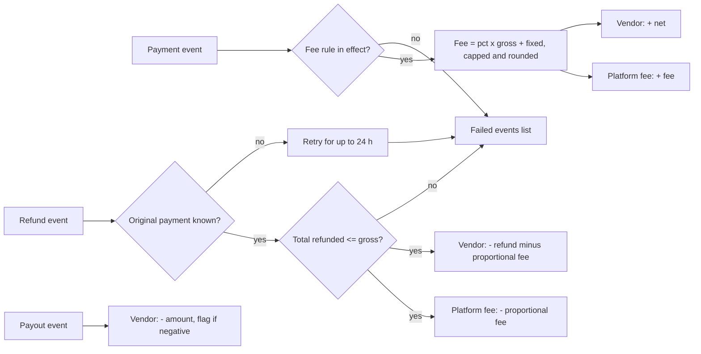

# Marketplace Balance Service: Product Brief

> **Approval gate:** `status` stays `draft` until the user reviews this document and approves it,
> either by setting `approved` themselves or by explicitly telling Claude to. `/software-architect` refuses to
> run until then. Any later change to this document resets `status` to `draft` and needs a new approval.

## 1. Summary
A service that consumes payment, refund and payout events and keeps an accurate, auditable balance
for every **vendor** and every **platform** (marketplace). End clients pay vendors through a
platform. The service calculates the platform's fee on each payment using that platform's fee rule,
credits the vendor with the net amount and credits the platform with the fee. Platform admins can
see all their vendors' balances and the fees collected. Vendor admins can track their own balance
and transaction history. Access is through an API only; existing portals render the data.

## 2. Problem
- **Current situation:** Nothing in the system tracks balances. Who is owed what, and how much fee
  each platform earned, has to be worked out from raw payment records (assumed, A-1).
- **Who is affected:** Platform admins (finance/ops at each marketplace) and vendor admins (each
  seller on a marketplace). Expected volume: about 50 platforms and 20,000 vendors (A-2).
- **Pain:** Vendors can't see how much they've earned, what fee was taken or what has been paid
  out. Platforms can't see what they owe vendors or what they've earned in fees. Disputes and
  manual reconciliation follow.
- **Evidence:** Assumed from the request. No tickets or data are available yet (A-1).
- **Cost of not solving:** Support load from balance questions, vendor churn caused by lack of
  trust, payout errors, and no financial reporting for platforms.

## 3. Goals and non-goals
**Goals**
- G-1: Every vendor and platform has a correct, up-to-date balance in each currency, derived only
  from payment events.
- G-2: Platform fees are calculated consistently and transparently according to each platform's
  configured fee rule.
- G-3: Platform admins and vendor admins can answer "what is my balance, and how did it get there?"
  on their own, without contacting support.

**Non-goals**
- Executing money movement (charging clients, sending payouts). The service only records events
  produced elsewhere.
- Currency conversion (FX) and reporting in a base currency. Each currency's balance is separate.
- Chargebacks and disputes. Deferred to a later release (FR-23).
- Its own web UI or dashboard. Existing platform and vendor portals consume the API.
- Tax calculation, invoicing and accounting-system exports.
- Holds, reserves, or a split between pending and available balance (FR-24, later).

## 4. Users and personas
| Persona | Description | Primary need |
|---------|-------------|--------------|
| Platform admin | Finance/ops user at one marketplace platform | See every vendor's balance on the platform, the fees collected, and set the platform's fee rule |
| Vendor admin | User managing one vendor on one platform | Track the vendor's balance and every payment, refund and payout that affected it |
| Upstream payment system | System that publishes payment, refund and payout events (not a human) | Have every event recorded exactly once |
| Operator / support (internal) | Team running the service | Find and resolve events that couldn't be applied, and verify that balances are correct |

## 5. User stories
| ID | As a… | I want… | So that… | Priority |
|----|-------|---------|----------|----------|
| US-1 | Vendor admin | to see my current balance in each currency | I know how much I'm owed | Must |
| US-2 | Vendor admin | to see a history of payments, refunds and payouts, each with its gross, fee and net amounts | I can understand and verify my balance | Must |
| US-3 | Platform admin | to see the balance of every vendor on my platform | I know what the platform owes each vendor | Must |
| US-4 | Platform admin | to see the total fees collected over a period, overall and per vendor | I can report the platform's revenue | Must |
| US-5 | Platform admin | to configure my platform's fee rule | fees match our commercial terms | Must |
| US-6 | Platform admin | to set a different fee rule for a specific vendor | I can honor deals negotiated with individual vendors | Should |
| US-7 | Upstream payment system | each event applied exactly once, even if it is delivered twice | balances are never double-counted | Must |
| US-8 | Operator | to see events that couldn't be applied, with the reason | I can fix the data and reprocess them | Must |
| US-9 | Vendor admin / platform admin | to see a balance as of a past date | I can reconcile at month end | Should |

## 6. Functional requirements
| ID | Requirement | Priority | Stories |
|----|-------------|----------|---------|
| FR-1 | The system shall consume **payment** events. Each one carries an event ID, platform, vendor, payment ID, gross amount, currency and occurrence time. | Must | US-7 |
| FR-2 | The system shall consume **refund** events (full or partial). Each one carries an event ID, the original payment ID, the refund amount, currency and occurrence time. | Must | US-7 |
| FR-3 | The system shall consume **payout** events. Each one carries an event ID, platform, vendor, payout ID, amount, currency and occurrence time. | Must | US-7 |
| FR-4 | For each payment, the system shall calculate the platform fee using the fee rule in effect for that vendor at the payment's occurrence time. | Must | US-5 |
| FR-5 | A fee rule shall consist of a percentage of the gross amount plus an optional fixed amount for each currency. The fee shall be capped at the gross amount and shall never be negative. | Must | US-5 |
| FR-6 | Fee amounts shall be rounded to the currency's minor unit (ISO 4217) using round-half-up. | Must | US-5 |
| FR-7 | A payment shall credit the vendor's balance with (gross − fee) and the platform's fee balance with the fee, both in the payment's currency. | Must | US-1, US-4 |
| FR-8 | A refund shall debit the vendor's balance with the refunded amount minus the proportional fee, and debit the platform's fee balance with the proportional fee (A-5). | Must | US-1, US-4 |
| FR-9 | The system shall reject a refund that would make the total refunded amount for a payment exceed that payment's gross amount, or whose currency differs from the payment's currency. | Must | US-7 |
| FR-10 | A payout shall debit the vendor's balance by the payout amount in its currency. | Must | US-1 |
| FR-11 | Balances may become negative (for example, a refund after a payout). The system shall record negative balances rather than reject the event, and shall flag them for operators. | Must | US-8 |
| FR-12 | The system shall keep a separate balance for each (vendor, currency) pair and each (platform, currency) pair. Amounts shall never be converted between currencies. | Must | US-1, US-3 |
| FR-13 | Processing the same event ID more than once shall have no further effect on balances. | Must | US-7 |
| FR-14 | A refund that arrives before its original payment shall be retried for up to 24 h. After that, it shall be moved to the failed-events list. | Must | US-7, US-8 |
| FR-15 | An event that can't be applied (unknown payment, no fee rule, invalid data or a rejected refund) shall be recorded in a failed-events list with a reason and shall not change any balance. | Must | US-8 |
| FR-16 | Operators shall be able to list failed events and trigger reprocessing of one or more of them. | Must | US-8 |
| FR-17 | Every balance change shall be traceable to exactly one source event. A balance shall always equal the sum of its recorded transactions. | Must | US-2 |
| FR-18 | Vendor admins shall be able to read their vendor's current balances (all currencies) and a paginated transaction history. The history can be filtered by date range, type (payment, refund or payout) and currency, and each entry shows the gross, fee, net and source IDs. | Must | US-1, US-2 |
| FR-19 | Platform admins shall be able to read the current balances of all vendors on their platform (paginated and sortable by balance) and any single vendor's transaction history. | Must | US-3 |
| FR-20 | Platform admins shall be able to read the total fees collected (net of refund reversals) for any date range, per currency, as a platform total and broken down by vendor. | Must | US-4 |
| FR-21 | Platform admins shall be able to create and update their platform's default fee rule. A change takes effect from a specified time that is not in the past and is never applied retroactively. Every version is kept. | Must | US-5 |
| FR-22 | Platform admins shall be able to set a fee rule for a specific vendor that overrides the platform default. | Should | US-6 |
| FR-25 | Vendor and platform admins shall be able to read balances as of a specified past timestamp. | Should | US-9 |
| FR-26 | Vendor admins shall be able to read the fee rule that currently applies to them. | Should | US-2 |
| FR-27 | A vendor shall be registered automatically when its platform's first event for it arrives. A platform must already exist, with a default fee rule, before its payments can be applied. | Must | US-7 |
| FR-23 | Handling chargebacks and disputes. | Won't (this release) | — |
| FR-24 | Pending and available balance split, reserves and holds. | Won't (this release) | — |

## 7. Non-functional requirements
| ID | Category | Requirement (measurable) |
|----|----------|--------------------------|
| NFR-1 | Freshness | p95 ≤ 5 s and p99 ≤ 30 s from when an event is published to when the balance reflects it, at peak load |
| NFR-2 | Performance (read) | p95 ≤ 300 ms for balance and history reads (page size ≤ 100) at 200 read requests/s. p95 ≤ 2 s for a fee report covering 1 year on a platform with 5,000 vendors |
| NFR-3 | Scale | Now: 50 platforms, 20,000 vendors, 1M events/day, peak 100 events/s. In 12 months: 250 platforms, 100,000 vendors, 5M events/day, peak 500 events/s (A-2) |
| NFR-4 | Accuracy | 0 discrepancies between balances and the sum of transactions, and 0 duplicate or lost events, checked by an automated daily reconciliation |
| NFR-5 | Durability | No accepted event is ever lost. Recovery point objective (RPO) = 0, recovery time objective (RTO) ≤ 1 h |
| NFR-6 | Availability | Read API at 99.9% per month. Event ingestion may pause, but must catch up without losing data once restored |
| NFR-7 | Security: authorization | A vendor admin can access only their own vendor's data, and a platform admin only their own platform's data. A 100% automated test suite covers cross-tenant access |
| NFR-8 | Security: data | All traffic encrypted in transit (TLS 1.2+) and data encrypted at rest. The service never receives or stores card data or end-client personal data beyond IDs (keeping it out of PCI DSS scope) |
| NFR-9 | Auditability | Transactions and fee-rule versions are append-only and retained for 7 years (A-6). Every fee-rule change records who made it and when |
| NFR-10 | Observability | Consumer lag, failed-event count and negative-balance count are exposed as metrics. An alert fires when lag exceeds 60 s or any failed event is older than 1 h |
| NFR-11 | Accessibility | N/A: there is no UI in scope. Consuming portals own accessibility |
| NFR-12 | Compatibility | The API is versioned. Breaking changes require a new version, and the previous version is supported for ≥ 6 months |

## 8. User experience and flows
API only, with no screens. These are the main flows:

States each read must define:
- **Empty:** a vendor with no transactions returns zero balances (no currencies listed) and an empty history. This is not an error.
- **Permission denied:** a request for another vendor's or platform's data is refused without revealing whether that data exists.
- **Not found:** an unknown vendor inside the caller's own platform returns a not-found response.
- **Stale data:** balance responses include the time of the last applied event, so consumers can show how fresh the data is.

## 9. Acceptance criteria
Example fee rule used below: platform P1 default rule = 10% + 0.30 USD.

| ID | Verifies | Given | When | Then |
|----|----------|-------|------|------|
| AC-1 | FR-1, FR-4, FR-5, FR-7 | Vendor V1 on P1 has 0 USD | A payment of 100.00 USD for V1 arrives | Fee = 10.30. V1 balance = 89.70 USD. P1 fee balance = 10.30 USD |
| AC-2 | FR-6 | P1 rule is 2.9% + 0.00 | A payment of 10.25 USD arrives | Fee = 0.30 (0.29725 rounded half-up). V1 is credited 9.95 |
| AC-3 | FR-5 | P1 rule is 10% + 0.30 USD | A payment of 0.20 USD arrives | Fee = 0.20 (capped at gross). V1 is credited 0.00 |
| AC-4 | FR-12 | V1 has 89.70 USD | A payment of 50.00 EUR arrives with an EUR rule of 10% + 0.25 | V1 shows two balances: 89.70 USD and 44.75 EUR. Nothing is converted |
| AC-5 | FR-2, FR-8 | The AC-1 payment (100.00 USD, fee 10.30) is applied | A partial refund of 50.00 USD arrives | Proportional fee = 5.15. V1 balance = 89.70 − 44.85 = 44.85. P1 fee balance = 5.15 |
| AC-6 | FR-9, FR-15 | 50.00 of the AC-1 payment has already been refunded | A refund of 60.00 USD for the same payment arrives | The refund is rejected and appears in failed events with the reason "exceeds refundable amount". Balances are unchanged |
| AC-7 | FR-14 | Payment PAY-9 has not been received | A refund for PAY-9 arrives, then PAY-9 arrives 10 min later | Both are applied in the correct order and the balances match AC-5's logic |
| AC-8 | FR-14, FR-15 | Payment PAY-10 is never received | A refund for PAY-10 arrives | After 24 h it appears in failed events with the reason "unknown payment". No balance changes |
| AC-9 | FR-13 | The AC-1 payment event has been applied | The same event ID is delivered again | Balances are unchanged and only one transaction is recorded |
| AC-10 | FR-3, FR-10 | V1 has 89.70 USD | A payout of 80.00 USD arrives | V1 balance = 9.70 USD |
| AC-11 | FR-11 | V1 has 9.70 USD after a payout | A full refund of a 100.00 USD payment (fee 10.30) arrives | V1 balance = −80.00 USD. The balance is flagged as negative and the metric increments |
| AC-12 | FR-15, FR-27 | Platform P2 has no fee rule | A payment for P2 arrives | The payment goes to failed events with the reason "no fee rule". No balance changes |
| AC-13 | FR-16 | The AC-12 event is in failed events | An operator sets P2's rule and reprocesses the event | The payment is applied and removed from failed events |
| AC-14 | FR-21 | P1 changes its rule to 8% + 0.30, effective 2026-12-01 00:00 UTC | Payments occur on 2026-11-30 23:59 and on 2026-12-01 00:01 | The first is charged 10% + 0.30 and the second 8% + 0.30. Earlier payments are not recalculated |
| AC-15 | FR-21 | It is now 2026-11-25 | A platform admin sets an effective time of 2026-11-20 | The change is rejected with an error that the effective time cannot be in the past |
| AC-16 | FR-22 | V1 has an override of 5% + 0 and V2 has none | Each receives a 100.00 USD payment | V1 fee = 5.00 and V2 fee = 10.30 |
| AC-17 | FR-18, NFR-7 | A vendor admin of V1 | Requests V1's balance, then V2's balance | V1: success. V2: permission denied, without revealing whether V2 exists |
| AC-18 | FR-19, NFR-7 | A platform admin of P1 | Lists vendor balances, then requests a vendor on P2 | P1 vendors are listed. The P2 request is denied |
| AC-19 | FR-18 | V3 exists but has no transactions | The vendor admin reads the balance and history | Empty balances and an empty history are returned with a success status |
| AC-20 | FR-18 | V1 has 250 transactions | History is requested with page size 100, type=refund and November 2026 | Only November refunds are returned, paginated, each with gross, fee, net and source IDs |
| AC-21 | FR-20 | P1 had fees of 10.30 + 10.30 USD and a reversal of 5.15 USD in November | Fees for November are requested | Total = 15.45 USD, broken down by vendor |
| AC-22 | FR-25 | V1 balance was 89.70 at 2026-11-10 and 9.70 now | A balance as of 2026-11-10 23:59 is requested | 89.70 USD is returned |
| AC-23 | FR-17, NFR-4 | Any day with 1M events processed | The daily reconciliation runs | Every balance equals the sum of its transactions, and the report shows 0 discrepancies |
| AC-24 | NFR-1 | Steady load of 100 events/s | Ingestion runs for 1 h | p95 time from publish to visible balance ≤ 5 s |
| AC-25 | FR-1, FR-15 | A payment event has a negative amount or an unsupported currency code | It is consumed | It goes to failed events with the reason "invalid data". No balance changes |

## 10. Success metrics
| ID | Metric | Baseline | Target | Measured by |
|----|--------|----------|--------|-------------|
| M-1 | Reconciliation discrepancies | Unknown (no service today), measure first | 0 per day | Daily reconciliation report |
| M-2 | Event-to-balance latency, p95 | N/A (new) | ≤ 5 s | Service metrics |
| M-3 | Failed events unresolved after 24 h | N/A (new) | < 0.01% of daily events | Failed-events metric |
| M-4 | Support tickets about vendor balances and fees | Unknown, measure first | −50% within 3 months of launch | Support ticket tagging |
| M-5 | Platforms whose portals show data from the balance API | 0 | ≥ 80% within 3 months | API client usage by platform |

## 11. Scope and release
- **MVP (this release):** FR-1 to FR-21, FR-27.
- **Next:** FR-22 (vendor fee overrides), FR-25 (balance as of a past date), FR-26.
- **Later:** FR-23 (chargebacks), FR-24 (pending/available split and reserves), FX reporting,
  accounting exports, webhooks that notify portals of balance changes.
- **Rollout:** Run in shadow mode on live events for ≥ 2 weeks, reconciling against existing payment
  records, before exposing the read API. Then onboard platforms one by one. Whether historical
  events need to be backfilled is unresolved (Q-3).
- **Launch dependencies:** API documentation for portal teams, an operator runbook for failed
  events, and fee rules configured for each platform before onboarding.

## 12. Dependencies and constraints
- An upstream payment system that publishes payment, refund and payout events with stable,
  unique event IDs (Q-1).
- An identity provider that can identify platform admins, vendor admins and operators, and the
  platform/vendor each one belongs to (Q-2).
- Existing platform and vendor portals, which will present the data. No UI is built here.

## 13. Assumptions
- A-1: No balance tracking exists today. *If wrong, we must migrate existing balances, which
  enlarges scope.*
- A-2: Volume is as stated in NFR-3. *If it is 10× higher, the architecture changes.*
- A-3: Payouts are decided and executed upstream. This service records them and does not approve
  or block them. *If it must approve payouts, a synchronous "check balance" capability is needed.*
- A-4: Every payment belongs to exactly one vendor on one platform (no split payments across
  vendors). *If wrong, payment events and fee calculation change.*
- A-5: Refunds reverse the fee proportionally, so the platform gives back its share. *If platforms
  keep the fee on refunds, FR-8 and AC-5 change (Q-4).*
- A-6: Financial records must be kept for 7 years. *If the requirement is different, adjust
  NFR-9.*
- A-7: Events may arrive duplicated or out of order, but each carries the time it occurred.
- A-8: Amounts in events are in a currency's minor or major unit with exact decimals (no floating
  point), and currencies are ISO 4217 codes.
- A-9: A vendor belongs to exactly one platform.

## 14. Risks
| ID | Risk | Likelihood | Impact | Mitigation |
|----|------|------------|--------|------------|
| R-1 | Duplicate or out-of-order events corrupt balances | High | High | Idempotency by event ID (FR-13), retry window (FR-14), daily reconciliation (NFR-4) |
| R-2 | A fee rule is misconfigured and fees are wrong at scale | Medium | High | No retroactive changes and full version history (FR-21). The fee rule is visible to vendors (FR-26) |
| R-3 | Payouts upstream ignore balances, causing negative balances | Medium | Medium | Flag and alert on negative balances (FR-11). Revisit A-3 |
| R-4 | Cross-tenant data leak | Low | High | NFR-7 test suite and denial without revealing existence (AC-17) |
| R-5 | Rounding disagreements with the upstream system or with platforms | Medium | Medium | Document the rounding rule (FR-6). Show the fee on every transaction |
| R-6 | Upstream event format is unknown or unstable | Medium | High | Resolve Q-1 before architecture. Version the event contract |

## 15. Open questions
| ID | Question | Owner | Blocking? |
|----|----------|-------|-----------|
| Q-1 | Which system publishes payment, refund and payout events, through what channel, in what format, and does it guarantee unique event IDs? | User / payments team | yes (architecture) |
| Q-2 | How are platform admins, vendor admins and operators authenticated today, and does an identity carry the platform and vendor it belongs to? | User / platform team | yes (architecture) |
| Q-3 | Must historical events be backfilled at launch, and how far back? | User | no |
| Q-4 | On a refund, is the fee reversed proportionally (assumed), kept by the platform, or configurable per platform? | User / finance | no (A-5 default) |
| Q-5 | Who may create and change fee rules: platform admins themselves (assumed), or only internal operators? | User | no |

## 16. Changelog
| Version | Date | Change |
|---------|------|--------|
| 1 | 2026-11-25 | Initial draft |
